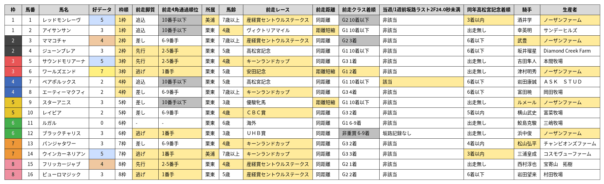

# 【スプリンターズS2026】傾向分析

※集計対象は、過去10年（2016〜2025年）に中山芝1200mで行われたスプリンターズS（10回）。

## 基本項目

### 人気

> 荒れるイメージがある

| 人気 | 着度数 | 勝率 | 複率 | 単回 | 複回 |
| --- | --- | --- | --- | --- | --- |
| 1人気 | 3-0-2-5 | 30% | 50% | 82% | 69% |
| 2人気 | 1-2-1-6 | 10% | 40% | 29% | 79% |
| 3人気 | 3-2-0-5 | 30% | 50% | **194%** | **112%** |
| 4-6人気 | 0-3-2-25 | 0% | 17% | 0% | 62% |
| 7-9人気 | 2-2-2-23 | 7% | 21% | **168%** | **115%** |
| 10人気以下 | 1-1-3-65 | 1% | 7% | 71% | 66% |

### 枠順

> 内枠優勢

| 枠順 | 着度数 | 勝率 | 複率 | 単回 | 複回 |
| --- | --- | --- | --- | --- | --- |
| 1枠 | 1-2-4-13 | 5% | 35% | **102%** | **178%** |
| 2枠 | 1-1-1-17 | 5% | 15% | 26% | 56% |
| 3枠 | 1-0-4-15 | 5% | 25% | 24% | 80% |
| 4枠 | 3-2-0-15 | 15% | 25% | 44% | 56% |
| 5枠 | 1-2-0-17 | 5% | 15% | 11% | 48% |
| 6枠 | 0-1-0-19 | 0% | 5% | 0% | 8% |
| 7枠 | 2-1-0-16 | 11% | 16% | **198%** | 86% |
| 8枠 | 1-1-1-17 | 5% | 15% | **250%** | **111%** |

### 脚質

> 差しも届くが、先行馬が好走率・回収率共に優秀

| 脚質 | 着度数 | 勝率 | 複率 | 単回 | 複回 |
| --- | --- | --- | --- | --- | --- |
| 逃げ | 0-3-1-6 | 0% | 40% | 0% | **136%** |
| 先行 | 5-4-2-24 | 14% | 31% | **311%** | **175%** |
| 差し | 4-3-4-50 | 7% | 18% | 30% | 53% |
| 追込 | 1-0-3-49 | 2% | 8% | 4% | 32% |

### 前走脚質

> 前走差しの方が優勢も、実際は先行馬の方が成績がいいためたまたまか？

| 前走脚質 | 着度数 | 勝率 | 複率 | 単回 | 複回 | 該当馬 |
| --- | --- | --- | --- | --- | --- | --- |
| 逃げ | 1-1-1-15 | 6% | 17% | **278%** | **117%** | 6, 12, 14, 16 |
| 先行 | 0-6-2-29 | 0% | 22% | 0% | 86% | 4, 5, 15 |
| 差し | 7-3-4-38 | 13% | 27% | **129%** | 99% | 3, 8, 9, 10, 13 |
| 追込 | 2-0-3-37 | 5% | 12% | 30% | 47% | 1, 2, 7 |

### 4角通過順位

| 4角通過順位 | 着度数 | 勝率 | 複率 | 単回 | 複回 |
| --- | --- | --- | --- | --- | --- |
| 1番手 | 0-3-1-6 | 0% | 40% | 0% | **136%** |
| 2-5番手 | 5-4-3-34 | 11% | 26% | **237%** | **150%** |
| 6-9番手 | 3-3-3-28 | 8% | 24% | 40% | 62% |
| 10番手以下 | 2-0-3-61 | 3% | 8% | 8% | 28% |

### 前走4角通過順位

| 前走4角通過順位 | 着度数 | 勝率 | 複率 | 単回 | 複回 | 該当馬 |
| --- | --- | --- | --- | --- | --- | --- |
| 1番手 | 1-1-1-15 | 6% | 17% | **278%** | **117%** | 6, 12, 14, 16 |
| 2-5番手 | 2-7-4-36 | 4% | 27% | 68% | **116%** | 4, 5, 15 |
| 6-9番手 | 6-1-2-24 | 18% | 27% | **129%** | 81% | 3, 8, 10, 13 |
| 10番手以下 | 1-1-3-40 | 2% | 11% | 7% | 44% | 1, 2, 7, 9 |

### 上がり3F順位

> 上がりは使えるに越したことはない

| 上がり3F順位 | 着度数 | 勝率 | 複率 | 単回 | 複回 |
| --- | --- | --- | --- | --- | --- |
| 1位 | 1-0-3-7 | 9% | 36% | 20% | **110%** |
| 2位 | 2-0-2-10 | 14% | 29% | 61% | **128%** |
| 3位 | 2-2-0-5 | 22% | 44% | 63% | **129%** |
| 4位以下 | 5-8-5-107 | 4% | 14% | 90% | 66% |

### 前走上がり3F順位

> あまり関係なさそう

| 前走上がり3F順位 | 着度数 | 勝率 | 複率 | 単回 | 複回 | 該当馬 |
| --- | --- | --- | --- | --- | --- | --- |
| 1位 | 3-0-1-16 | 15% | 20% | 72% | 40% | 1 |
| 2位 | 0-1-1-16 | 0% | 11% | 0% | 58% | 2, 3 |
| 3位 | 2-1-0-13 | 12% | 19% | 38% | 50% | 13 |
| 4位以下 | 5-8-8-81 | 5% | 21% | **107%** | 96% | その他 |

### 所属

> 美浦が母数の割りに優秀

| 所属 | 着度数 | 勝率 | 複率 | 単回 | 複回 | 該当馬 |
| --- | --- | --- | --- | --- | --- | --- |
| 美浦 | 5-2-2-27 | 14% | 25% | **188%** | **106%** | 1, 14 |
| 栗東 | 5-8-8-98 | 4% | 18% | 52% | 72% | その他 |
| 海外 | 0-0-0-4 | 0% | 0% | 0% | 0% |  |

### 馬齢

> 4歳が主役

| 馬齢 | 着度数 | 勝率 | 複率 | 単回 | 複回 | 該当馬 |
| --- | --- | --- | --- | --- | --- | --- |
| 3歳 | 1-2-1-15 | 5% | 21% | 28% | **103%** | 9, 12 |
| 4歳 | 4-4-4-26 | 11% | 32% | **101%** | 96% | 2, 5, 10, 13, 15 |
| 5歳 | 2-4-1-37 | 5% | 16% | 27% | 45% | 4, 6, 7, 16 |
| 6歳 | 1-0-3-28 | 3% | 12% | 10% | 52% | 11 |
| 7歳以上 | 2-0-1-23 | 8% | 12% | **270%** | **120%** | 1, 3, 8, 14 |

### 性別

> 牝馬も頑張ってはいる

| 性別 | 着度数 | 勝率 | 複率 | 単回 | 複回 | 該当馬 |
| --- | --- | --- | --- | --- | --- | --- |
| 牡 | 8-5-4-78 | 8% | 18% | **129%** | 84% | 1, 6, 7, 8, 10, 11, 13, 14, 15 |
| 牝 | 2-5-6-45 | 3% | 22% | 12% | 76% | 2, 3, 4, 5, 9, 12, 16 |
| セン | 0-0-0-6 | 0% | 0% | 0% | 0% |  |

### 馬体重

| 馬体重 | 着度数 | 勝率 | 複率 | 単回 | 複回 | 該当馬 |
| --- | --- | --- | --- | --- | --- | --- |
| 459kg以下 | 0-1-2-18 | 0% | 14% | 0% | **108%** | 2, 5 |
| 460-479kg | 3-3-6-34 | 7% | 26% | 33% | 85% | 6, 8, 12, 16 |
| 480-499kg | 1-3-1-34 | 3% | 13% | 13% | 48% | 4, 7, 9, 13 |
| 500-519kg | 4-2-1-27 | 12% | 21% | **222%** | 91% | 1, 3, 10, 14, 15 |
| 520kg以上 | 2-1-0-16 | 11% | 16% | **178%** | 65% | 11 |

## 前走

### 前走レース

> セントウルS、キーンランドC、北九州記念が主要ローテ。
> 安田記念はメンバーレベルと距離短縮が効いてか出走数は少ないも好走率が高い。

| 前走レース | 着度数 | 勝率 | 複率 | 単回 | 複回 | 該当馬 |
| --- | --- | --- | --- | --- | --- | --- |
| 産経賞セントウルステークス | 3-4-1-44 | 6% | 15% | 21% | 60% | 1, 3, 15, 16 |
| キーンランドカップ | 1-1-4-35 | 2% | 15% | **122%** | 75% | 5, 8, 13, 14 |
| テレビ西日本賞北九州記念 | 2-1-1-17 | 10% | 19% | **120%** | 72% |  |
| 安田記念 | 2-0-1-4 | 29% | 43% | 77% | **120%** | 6 |
| ＣＢＣ賞 | 1-2-0-2 | 20% | 60% | **184%** | **248%** | 10 |
| 高松宮記念 | 1-1-0-2 | 25% | 50% | **712%** | **252%** | 4, 7 |
| 函館スプリントステークス | 0-0-1-4 | 0% | 20% | 0% | 42% |  |
| ヴィクトリアマイル | 0-1-0-1 | 0% | 50% | 0% | **150%** | 2 |
| 優駿牝馬 | 0-0-0-1 | 0% | 0% | 0% | 0% | 9 |
| 京王杯スプリングカップ | 0-0-0-2 | 0% | 0% | 0% | 0% |  |
| アイビスサマーダッシュ | 0-0-0-4 | 0% | 0% | 0% | 0% |  |
| エルムステークス | 0-0-0-1 | 0% | 0% | 0% | 0% |  |
| 京成杯オータムハンデキャップ | 0-0-0-1 | 0% | 0% | 0% | 0% |  |
| その他 | 0-0-2-11 | 0% | 15% | 0% | 86% | 11, 12 |

### 前走距離

> 距離短縮が優勢。1400m適性が求められる？

| 前走距離 | 着度数 | 勝率 | 複率 | 単回 | 複回 | 該当馬 |
| --- | --- | --- | --- | --- | --- | --- |
| 距離延長 | 0-0-0-4 | 0% | 0% | 0% | 0% |  |
| 同距離 | 8-9-7-113 | 6% | 18% | 90% | 74% | その他 |
| 距離短縮 | 2-1-3-12 | 11% | 33% | 30% | **126%** | 2, 6, 9 |

### 前走クラス

> 前走G1が好走率・回収率共に優秀

| 前走クラス | 着度数 | 勝率 | 複率 | 単回 | 複回 | 該当馬 |
| --- | --- | --- | --- | --- | --- | --- |
| G1 | 3-2-1-14 | 15% | 30% | **170%** | **108%** | 2, 4, 6, 7, 9, 11 |
| G2 | 3-4-1-46 | 6% | 15% | 20% | 57% | 1, 3, 15, 16 |
| G3 | 4-4-6-66 | 5% | 18% | **106%** | 75% | 5, 8, 10, 13, 14 |
| リステッド | 0-0-1-0 | 0% | 100% | 0% | **770%** |  |
| オープン | 0-0-1-1 | 0% | 50% | 0% | **175%** | 12 |
| 海外 | 0-0-0-2 | 0% | 0% | 0% | 0% |  |

### 前走G1着順

> G1なら大敗も許容

| 前走G1着順 | 着度数 | 勝率 | 複率 | 単回 | 複回 | 該当馬 |
| --- | --- | --- | --- | --- | --- | --- |
| 1着 | 1-0-0-0 | 100% | 100% | **220%** | **140%** |  |
| 2着 | 0-1-0-2 | 0% | 33% | 0% | 97% | 6 |
| 3着 | 1-0-0-0 | 100% | 100% | **320%** | **140%** |  |
| 4着 | 0-0-0-1 | 0% | 0% | 0% | 0% |  |
| 5着 | 0-0-0-1 | 0% | 0% | 0% | 0% |  |
| 6-9着 | 0-0-1-3 | 0% | 25% | 0% | **140%** | 11 |
| 10着以下 | 1-1-0-7 | 11% | 22% | **317%** | **113%** | 2, 4, 7, 9 |

### 前走G2着順

> 掲示板は必須

| 前走G2着順 | 着度数 | 勝率 | 複率 | 単回 | 複回 | 該当馬 |
| --- | --- | --- | --- | --- | --- | --- |
| 1着 | 2-3-0-6 | 18% | 45% | 52% | 90% | 15 |
| 2着 | 1-1-0-8 | 10% | 20% | 53% | 71% | 16 |
| 3着 | 0-0-0-6 | 0% | 0% | 0% | 0% | 3 |
| 4着 | 0-0-0-2 | 0% | 0% | 0% | 0% |  |
| 5着 | 0-0-1-2 | 0% | 33% | 0% | **467%** |  |
| 6-9着 | 0-0-0-15 | 0% | 0% | 0% | 0% |  |
| 10着以下 | 0-0-0-7 | 0% | 0% | 0% | 0% | 1 |

### 前走G3着順

> 稀に巻き返しもあり

| 前走G3着順 | 着度数 | 勝率 | 複率 | 単回 | 複回 | 該当馬 |
| --- | --- | --- | --- | --- | --- | --- |
| 1着 | 1-0-2-15 | 6% | 17% | 51% | 36% | 5 |
| 2着 | 1-2-0-13 | 6% | 19% | 31% | 77% | 10, 13 |
| 3着 | 0-0-1-5 | 0% | 17% | 0% | **113%** | 14 |
| 4着 | 0-1-1-2 | 0% | 50% | 0% | **230%** | 8 |
| 5着 | 1-0-1-1 | 33% | 67% | **1667%** | **517%** |  |
| 6-9着 | 0-1-1-14 | 0% | 12% | 0% | 33% |  |
| 10着以下 | 1-0-0-16 | 6% | 6% | **119%** | 28% |  |

### 前走非重賞着順

> 母数が少ないのでなんとも言えないが、勝利はしていて欲しい

| 前走非重賞着順 | 着度数 | 勝率 | 複率 | 単回 | 複回 | 該当馬 |
| --- | --- | --- | --- | --- | --- | --- |
| 1着 | 0-0-1-1 | 0% | 50% | 0% | **175%** |  |
| 2着 | 0-0-0-2 | 0% | 0% | 0% | 0% |  |
| 3着 | 0-0-0-0 | - | - | - | - |  |
| 4着 | 0-0-0-0 | - | - | - | - |  |
| 5着 | 0-0-1-0 | 0% | 100% | 0% | **770%** |  |
| 6-9着 | 0-0-0-0 | - | - | - | - | 12 |
| 10着以下 | 0-0-0-0 | - | - | - | - |  |

## 実績

### 重賞勝利数

| 重賞勝利数 | 着度数 | 勝率 | 複率 | 単回 | 複回 | 該当馬 |
| --- | --- | --- | --- | --- | --- | --- |
| 0勝 | 1-3-2-23 | 3% | 21% | 17% | **114%** | 4, 10 |
| 1勝 | 3-2-3-48 | 5% | 14% | 77% | 71% | 1, 2, 5, 6, 7, 8, 12 |
| 2勝以上 | 6-5-5-58 | 8% | 22% | **110%** | 69% | 3, 9, 11, 13, 14, 15, 16 |

### 中山勝利数

| 中山勝利数 | 着度数 | 勝率 | 複率 | 単回 | 複回 | 該当馬 |
| --- | --- | --- | --- | --- | --- | --- |
| 0勝 | 6-4-9-73 | 7% | 21% | 58% | 89% | 2, 6, 8, 9, 10, 13, 15, 16 |
| 1勝 | 2-4-0-31 | 5% | 16% | 16% | 39% | 5, 11, 12 |
| 2勝以上 | 2-2-1-25 | 7% | 17% | **234%** | 93% | 1, 3, 4, 7, 14 |

### 中山重賞好走実績

> 中山実績はなくてもいい

| 中山重賞好走実績 | 着度数 | 勝率 | 複率 | 単回 | 複回 | 該当馬 |
| --- | --- | --- | --- | --- | --- | --- |
| 0回 | 8-7-7-89 | 7% | 20% | 95% | 90% | その他 |
| 1回 | 1-2-2-24 | 3% | 17% | 11% | 53% | 4, 10, 12, 14 |
| 2回 | 0-1-1-10 | 0% | 17% | 0% | 32% | 3, 7, 11 |
| 3回以上 | 1-0-0-6 | 14% | 14% | **290%** | 67% |  |

### リピーター

> リピーターレースではない

| リピーター | 着度数 | 勝率 | 複率 | 単回 | 複回 | 該当馬 |
| --- | --- | --- | --- | --- | --- | --- |
| 前年3着以内 | 1-1-2-14 | 6% | 22% | 18% | 46% | 4, 14 |
| 前年4着以内 | 1-2-2-20 | 4% | 20% | 13% | 45% | 4, 14 |
| 前年5着以内 | 1-2-3-24 | 3% | 20% | 11% | 42% | 4, 14 |
| 前年6着以下 | 2-1-0-24 | 7% | 11% | 86% | 34% | 3, 7, 11, 16 |
| 前年出走無し | 7-7-7-81 | 7% | 21% | **101%** | 100% | その他 |

## 調教

### 当週/1週前坂路ラスト2F24.0秒未満

> とりあえず買っておいていいレベル

| 当週/1週前坂路ラスト2F24.0秒未満 | 着度数 | 勝率 | 複率 | 単回 | 複回 | 該当馬 |
| --- | --- | --- | --- | --- | --- | --- |
| 該当 | 2-3-1-10 | 12% | 38% | **305%** | **152%** | 7 |
| 非該当 | 8-7-9-102 | 6% | 19% | 64% | 79% | その他 |
| 坂路記録なし | 0-0-0-17 | 0% | 0% | 0% | 0% | 12 |

## 同年/前年レース実績

同年/前年の指定したレースでの実績

### 同年高松宮記念着順

> 強い馬は高松宮記念もスプリンターズSも好走するが、求められる適性が異なるので掲示板外からの巻き返しも多い。

| 同年高松宮記念着順 | 着度数 | 勝率 | 複率 | 単回 | 複回 | 該当馬 |
| --- | --- | --- | --- | --- | --- | --- |
| 3着以内 | 3-3-4-13 | 13% | 43% | 36% | **104%** | 1, 14 |
| 4着以内 | 3-3-5-17 | 11% | 39% | 29% | 90% | 1, 13, 14 |
| 5着以内 | 3-3-5-19 | 10% | 37% | 27% | 84% | 1, 10, 13, 14 |
| 6着以下 | 2-3-3-35 | 5% | 19% | **113%** | **101%** | 3, 4, 7, 8, 16 |
| 出走無し | 5-4-2-75 | 6% | 13% | 84% | 64% | 2, 5, 6, 9, 11, 12, 15 |

## 馬以外の属性

### 騎手

| 騎手 | 着度数 | 勝率 | 複率 | 単回 | 複回 | 該当馬 |
| --- | --- | --- | --- | --- | --- | --- |
| ルメール | 2-1-1-2 | 33% | 67% | 85% | **107%** | 9 |
| 川田将雅 | 2-1-1-4 | 25% | 50% | 96% | 79% |  |
| 松山弘平 | 0-2-1-3 | 0% | 50% | 0% | **247%** | 13 |
| 武豊　　 | 0-1-1-5 | 0% | 29% | 0% | **277%** | 3 |
| Ｍ．デム | 2-0-0-1 | 67% | 67% | **413%** | **173%** |  |
| 三浦皇成 | 1-0-0-4 | 20% | 20% | **1000%** | **250%** | 14 |
| 丸田恭介 | 0-0-1-1 | 0% | 50% | 0% | **280%** |  |
| 吉田隼人 | 0-0-1-0 | 0% | 100% | 0% | **770%** | 5 |
| 和田竜二 | 0-1-0-2 | 0% | 33% | 0% | **170%** |  |
| 坂井瑠星 | 0-1-0-2 | 0% | 33% | 0% | **107%** | 4 |
| 岩田康誠 | 0-1-0-5 | 0% | 17% | 0% | 50% | 7 |
| 松若風馬 | 0-1-0-3 | 0% | 25% | 0% | 45% |  |
| 横山武史 | 0-0-1-3 | 0% | 25% | 0% | 75% | 10 |
| 浜中俊　 | 0-0-1-6 | 0% | 14% | 0% | 20% | 12 |
| 田辺裕信 | 0-0-1-1 | 0% | 50% | 0% | **370%** |  |
| 石橋脩　 | 0-0-1-1 | 0% | 50% | 0% | **175%** |  |
| 福永祐一 | 1-0-0-5 | 17% | 17% | 88% | 33% |  |
| 荻野極　 | 1-0-0-0 | 100% | 100% | **2030%** | **470%** |  |
| 菅原明良 | 0-1-0-0 | 0% | 100% | 0% | **370%** |  |
| 西村淳也 | 1-0-0-2 | 33% | 33% | **950%** | **240%** | 15 |
| その他 | 0-0-0-79 | 0% | 0% | 0% | 0% | その他 |

### 生産者

| 生産者 | 着度数 | 勝率 | 複率 | 単回 | 複回 | 該当馬 |
| --- | --- | --- | --- | --- | --- | --- |
| ノーザンファーム | 3-2-1-20 | 12% | 23% | 48% | 64% | 1, 3, 6, 9, 12 |
| 谷川牧場 | 0-0-3-1 | 0% | 75% | 0% | **162%** |  |
| ケイアイファーム | 0-1-1-3 | 0% | 40% | 0% | 60% |  |
| コスモヴューファーム | 1-1-0-3 | 20% | 40% | **1000%** | **352%** | 14 |
| ダーレー・ジャパン・ファーム | 2-0-0-4 | 33% | 33% | 95% | 47% |  |
| 社台ファーム | 2-0-0-5 | 29% | 29% | **177%** | 74% |  |
| Alpha Delta Stables LLC | 0-1-0-2 | 0% | 33% | 0% | 60% |  |
| Diamond Creek Farm | 0-1-0-0 | 0% | 100% | 0% | **540%** | 4 |
| Hinkle Farms | 0-0-1-0 | 0% | 100% | 0% | **770%** |  |
| Moyglare Stud Farm Ltd | 0-1-0-1 | 0% | 50% | 0% | **160%** |  |
| North Hills Co. Limited | 1-0-0-1 | 50% | 50% | **1015%** | **235%** |  |
| 三嶋牧場 | 1-0-0-4 | 20% | 20% | **570%** | **144%** | 11 |
| 坂戸　節子 | 0-0-1-1 | 0% | 50% | 0% | **280%** |  |
| 奥山　博 | 0-1-0-3 | 0% | 25% | 0% | **128%** |  |
| 岡田スタツド | 0-0-1-2 | 0% | 33% | 0% | **117%** |  |
| 服部　牧場 | 0-1-0-1 | 0% | 50% | 0% | **185%** |  |
| 清水牧場 | 0-1-0-3 | 0% | 25% | 0% | 75% |  |
| 社台コーポレーション白老ファーム | 0-0-1-0 | 0% | 100% | 0% | **740%** |  |
| 藤原牧場 | 0-0-1-2 | 0% | 33% | 0% | **467%** |  |
| その他 | 0-0-0-73 | 0% | 0% | 0% | 0% | 2, 5, 7, 8, 10, 13, 15, 16 |

### 種牡馬

| 種牡馬 | 着度数 | 勝率 | 複率 | 単回 | 複回 | 該当馬 |
| --- | --- | --- | --- | --- | --- | --- |
| スウェプトオーヴァーボード | 2-0-1-1 | 50% | 75% | **310%** | **480%** |  |
| ミッキーアイル | 0-0-3-4 | 0% | 43% | 0% | 93% | 5 |
| アドマイヤムーン | 1-0-1-6 | 12% | 25% | 35% | 62% |  |
| ダイワメジャー | 0-1-1-3 | 0% | 40% | 0% | **180%** |  |
| ディープインパクト | 1-1-0-5 | 14% | 29% | 31% | 61% |  |
| ロードカナロア | 0-1-1-13 | 0% | 13% | 0% | 20% | 1, 6 |
| American Pharoah | 0-1-0-0 | 0% | 100% | 0% | **540%** | 4 |
| Dark Angel | 0-1-0-1 | 0% | 50% | 0% | **160%** |  |
| First Samurai | 0-0-1-0 | 0% | 100% | 0% | **770%** |  |
| Kitten's Joy | 1-0-0-1 | 50% | 50% | **1015%** | **235%** |  |
| Raven's Pass | 1-0-0-0 | 100% | 100% | **290%** | **130%** |  |
| Speightstown | 0-1-0-2 | 0% | 33% | 0% | 60% |  |
| アイルハヴアナザー | 0-1-0-2 | 0% | 33% | 0% | **170%** |  |
| キングカメハメハ | 0-1-0-3 | 0% | 25% | 0% | 75% |  |
| クロフネ | 1-0-0-2 | 33% | 33% | **163%** | 60% | 3 |
| ゴールドアリュール | 0-0-1-1 | 0% | 50% | 0% | **280%** |  |
| ショウナンカンプ | 0-1-0-2 | 0% | 33% | 0% | **170%** |  |
| ジャスタウェイ | 0-0-1-1 | 0% | 50% | 0% | **340%** |  |
| スクリーンヒーロー | 1-0-0-3 | 25% | 25% | **1250%** | **312%** | 14 |
| ドゥラメンテ | 1-0-0-1 | 50% | 50% | **1425%** | **360%** | 11 |
| ビッグアーサー | 0-1-0-2 | 0% | 33% | 0% | **123%** |  |
| モーリス | 1-0-0-2 | 33% | 33% | **177%** | 67% |  |
| その他 | 0-0-0-74 | 0% | 0% | 0% | 0% | その他 |

## 比較表

複勝率に差が出る項目を並べて比較した表。  
黄色はプラスデータ、灰色はマイナスデータ。  
「好データ」はプラスデータの該当数を数えたもの。

