# 【秋華賞2026】前日の傾向

## 前日の出目

各要素において、前日のレースのうち秋華賞と同じ競馬場、芝ダのレースで3着以内に入った頭数を集計。

**人気**

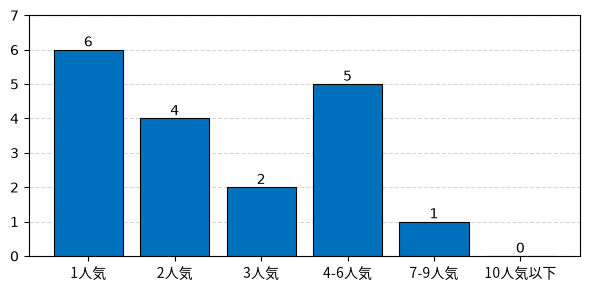

**枠番**

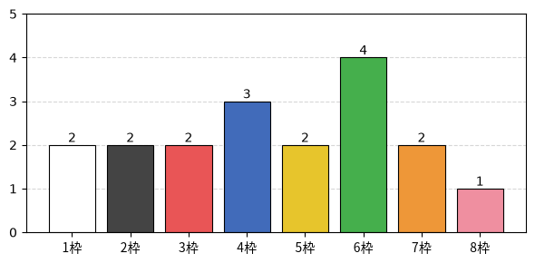

**[脚質](http://next5.jra-van.jp/appli/kyakushitsu3.html)**

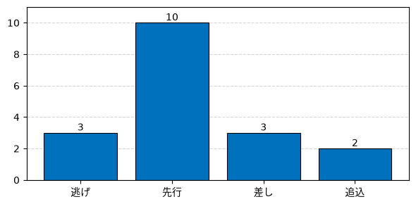

**上がり順位**

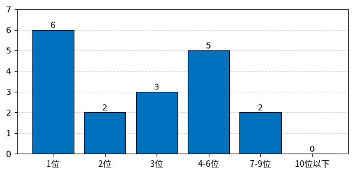

## 展開有利度の傾向

差し有利度・外枠有利度・外有利度は、それぞれ4角通過位置・馬番・コーナーでの内外の位置と走破タイムの相関係数を100倍したもの。正なら差し・外枠・外を回した馬が有利。

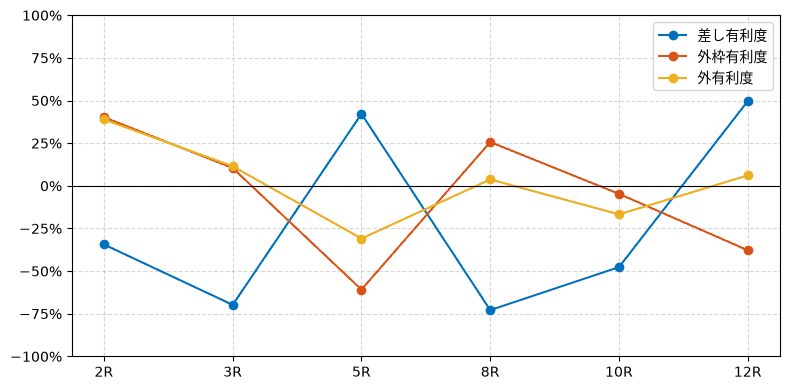

## 各レースの結果

### 京都2R 未勝利 1200m 11頭

| 着順 | 枠番 | 人気 | 4角通過 | 後3F |
| --- | --- | --- | --- | --- |
| 1着 | 6枠 7番 | 4人気 | 2番手 (先) | 34.0秒 (2位) |
| 2着 | 6枠 6番 | 2人気 | 2番手 (先) | 34.2秒 (5位) |
| 3着 | 1枠 1番 | 1人気 | 4番手 (先) | 34.2秒 (5位) |

| 差し有利度 | 外枠有利度 | 外有利度 |
| --- | --- | --- |
| -34% | +40% | +39% |

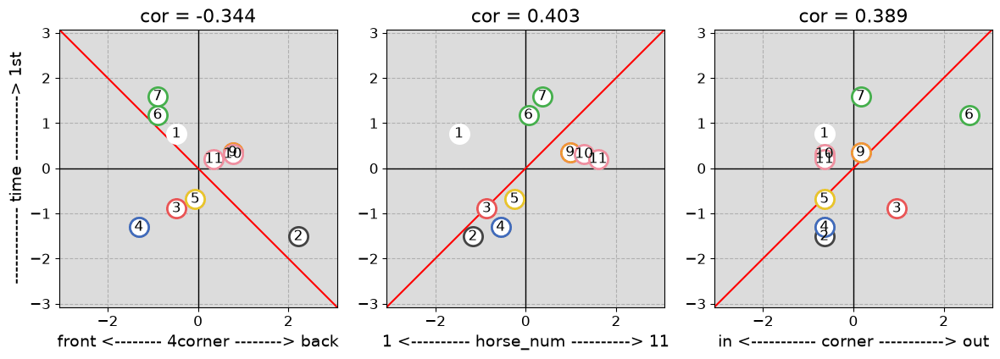

### 京都3R 未勝利 2000m 8頭

| 着順 | 枠番 | 人気 | 4角通過 | 後3F |
| --- | --- | --- | --- | --- |
| 1着 | 4枠 4番 | 5人気 | 1番手 (逃) | 33.9秒 (3位) |
| 2着 | 5枠 5番 | 3人気 | 3番手 (先) | 33.8秒 (1位) |
| 3着 | 8枠 8番 | 1人気 | 3番手 (先) | 33.8秒 (1位) |

| 差し有利度 | 外枠有利度 | 外有利度 |
| --- | --- | --- |
| -70% | +10% | +11% |

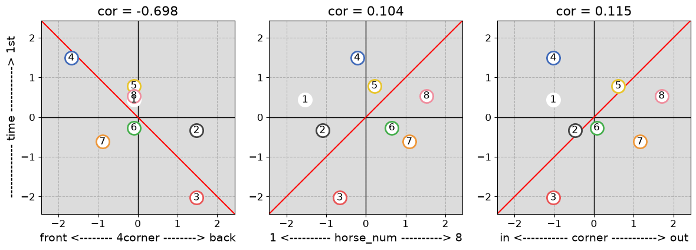

### 京都5R 新馬 1800m 8頭

| 着順 | 枠番 | 人気 | 4角通過 | 後3F |
| --- | --- | --- | --- | --- |
| 1着 | 1枠 1番 | 5人気 | 6番手 (追) | 34.3秒 (1位) |
| 2着 | 2枠 2番 | 2人気 | 7番手 (追) | 34.3秒 (1位) |
| 3着 | 4枠 4番 | 1人気 | 3番手 (先) | 34.9秒 (3位) |

| 差し有利度 | 外枠有利度 | 外有利度 |
| --- | --- | --- |
| +42% | -61% | -31% |

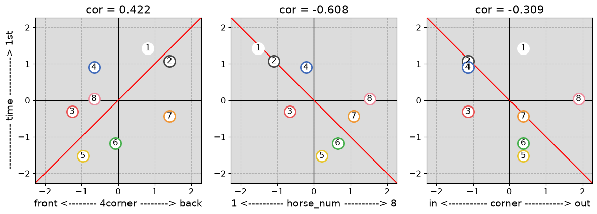

### 京都8R オープン(特別) 1400m 7頭

| 着順 | 枠番 | 人気 | 4角通過 | 後3F |
| --- | --- | --- | --- | --- |
| 1着 | 7枠 7番 | 1人気 | 1番手 (逃) | 33.9秒 (5位) |
| 2着 | 3枠 3番 | 2人気 | 2番手 (先) | 33.7秒 (3位) |
| 3着 | 6枠 6番 | 3人気 | 3番手 (先) | 33.5秒 (1位) |

| 差し有利度 | 外枠有利度 | 外有利度 |
| --- | --- | --- |
| -73% | +26% | +4% |

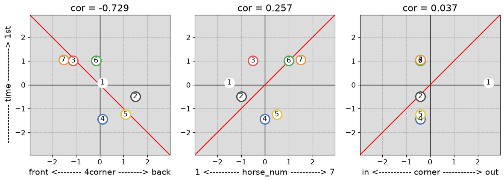

### 京都10R 2勝クラス(特別) 2200m 9頭

| 着順 | 枠番 | 人気 | 4角通過 | 後3F |
| --- | --- | --- | --- | --- |
| 1着 | 6枠 6番 | 1人気 | 5番手 (差) | 34.1秒 (1位) |
| 2着 | 2枠 2番 | 4人気 | 2番手 (先) | 34.7秒 (2位) |
| 3着 | 7枠 7番 | 2人気 | 1番手 (逃) | 35.0秒 (5位) |

| 差し有利度 | 外枠有利度 | 外有利度 |
| --- | --- | --- |
| -48% | -5% | -17% |

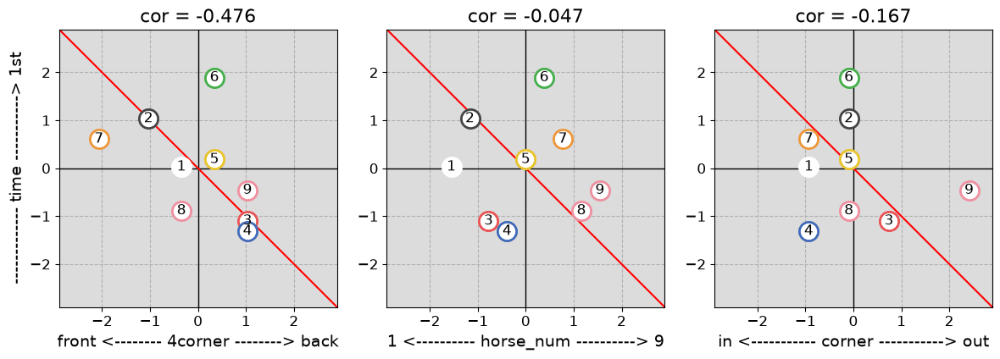

### 京都12R 1勝クラス 1400m 18頭

| 着順 | 枠番 | 人気 | 4角通過 | 後3F |
| --- | --- | --- | --- | --- |
| 1着 | 3枠 5番 | 8人気 | 2番手 (先) | 34.4秒 (8位) |
| 2着 | 4枠 7番 | 5人気 | 5番手 (差) | 34.3秒 (7位) |
| 2着 | 5枠 10番 | 1人気 | 9番手 (差) | 34.0秒 (5位) |

| 差し有利度 | 外枠有利度 | 外有利度 |
| --- | --- | --- |
| +50% | -38% | +6% |

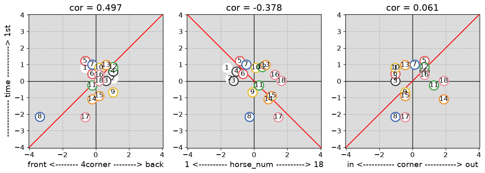
