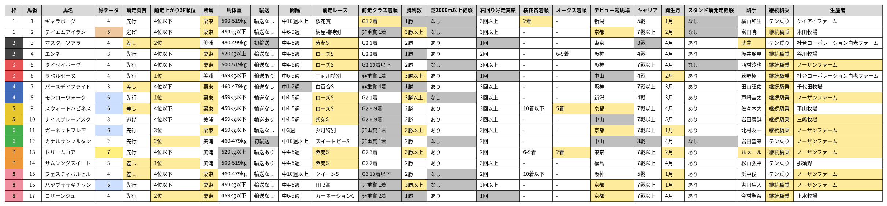

# 【秋華賞2026】傾向分析

※集計対象は、過去10年（2016〜2025年）に京都芝2000mで行われた秋華賞（8回）。

## 基本項目

### 人気

| 人気 | 着度数 | 勝率 | 複率 | 単回 | 複回 |
| --- | --- | --- | --- | --- | --- |
| 1人気 | 4-0-0-4 | 50% | 50% | 76% | 55% |
| 2人気 | 1-1-2-4 | 12% | 50% | 69% | 92% |
| 3人気 | 2-1-1-4 | 25% | 50% | **158%** | **111%** |
| 4-6人気 | 1-5-2-16 | 4% | 33% | 29% | **115%** |
| 7-9人気 | 0-0-2-22 | 0% | 8% | 0% | 45% |
| 10人気以下 | 0-1-1-65 | 0% | 3% | 0% | 16% |

### 枠順

| 枠順 | 着度数 | 勝率 | 複率 | 単回 | 複回 |
| --- | --- | --- | --- | --- | --- |
| 1枠 | 0-0-2-12 | 0% | 14% | 0% | 28% |
| 2枠 | 0-1-1-13 | 0% | 13% | 0% | 43% |
| 3枠 | 3-0-0-13 | 19% | 19% | 64% | 29% |
| 4枠 | 1-3-1-11 | 6% | 31% | 39% | 89% |
| 5枠 | 0-1-0-15 | 0% | 6% | 0% | 35% |
| 6枠 | 2-2-0-12 | 12% | 25% | 42% | 74% |
| 7枠 | 2-1-2-18 | 9% | 22% | 34% | 71% |
| 8枠 | 0-0-2-21 | 0% | 9% | 0% | 30% |

### 脚質

| 脚質 | 着度数 | 勝率 | 複率 | 単回 | 複回 |
| --- | --- | --- | --- | --- | --- |
| 逃げ | 0-2-0-7 | 0% | 22% | 0% | 93% |
| 先行 | 2-0-1-22 | 8% | 12% | 26% | 24% |
| 差し | 5-4-6-46 | 8% | 25% | 38% | 72% |
| 追込 | 1-2-1-40 | 2% | 9% | 3% | 26% |

### 前走脚質

<table>
<thead>
<tr><th>前走脚質</th><th>着度数</th><th>勝率</th><th>複率</th><th>単回</th><th>複回</th><th>該当馬</th></tr>
</thead>
<tbody>
<tr><td>逃げ</td><td>0-1-0-11</td><td>0%</td><td>8%</td><td>0%</td><td>23%</td><td>2, 10</td></tr>
<tr><td>先行</td><td>0-2-2-39</td><td>0%</td><td>9%</td><td>0%</td><td>34%</td><td>その他</td></tr>
<tr><td style="background-color:#FFEB9C">差し</td><td style="background-color:#FFEB9C">7-3-6-50</td><td style="background-color:#FFEB9C">11%</td><td style="background-color:#FFEB9C">24%</td><td style="background-color:#FFEB9C">45%</td><td style="background-color:#FFEB9C">71%</td><td style="background-color:#FFEB9C">3, 7, 9, 14, 15</td></tr>
<tr><td>追込</td><td>1-2-0-15</td><td>6%</td><td>17%</td><td>8%</td><td>33%</td><td></td></tr>
</tbody>
</table>

### 4角通過順位

| 通過 | 着度数 | 勝率 | 複率 | 単回 | 複回 |
| --- | --- | --- | --- | --- | --- |
| 1番手 | 0-2-0-6 | 0% | 25% | 0% | **105%** |
| 2-4番手 | 2-0-1-23 | 8% | 12% | 25% | 23% |
| 5-7番手 | 3-3-2-25 | 9% | 24% | 32% | 57% |
| 8-10番手 | 2-0-2-18 | 9% | 18% | 57% | 51% |
| 11番手以下 | 1-3-3-43 | 2% | 14% | 3% | 51% |

### 前走4角通過順位

| 通過 | 着度数 | 勝率 | 複率 | 単回 | 複回 | 該当馬 |
| --- | --- | --- | --- | --- | --- | --- |
| 1番手 | 0-1-1-13 | 0% | 13% | 0% | 33% | 2, 10 |
| 2-4番手 | 0-2-1-37 | 0% | 8% | 0% | 31% | その他 |
| 5-7番手 | 4-2-4-27 | 11% | 27% | 40% | 88% | 3, 7, 9, 14, 15 |
| 8-10番手 | 1-2-1-19 | 4% | 17% | 10% | 49% |  |
| 11番手以下 | 3-1-1-19 | 12% | 21% | 58% | 37% |  |

### 上がり3F順位

| 後3F順位 | 着度数 | 勝率 | 複率 | 単回 | 複回 |
| --- | --- | --- | --- | --- | --- |
| 1位 | 3-2-3-1 | 33% | 89% | **154%** | **307%** |
| 2位 | 4-2-0-4 | 40% | 60% | **117%** | **130%** |
| 3位 | 0-0-3-6 | 0% | 33% | 0% | 70% |
| 4位以下 | 1-4-2-104 | 1% | 6% | 5% | 21% |

### 前走上がり3F順位

<table>
<thead>
<tr><th>前走後3F順位</th><th>着度数</th><th>勝率</th><th>複率</th><th>単回</th><th>複回</th><th>該当馬</th></tr>
</thead>
<tbody>
<tr><td style="background-color:#FFEB9C">1位</td><td style="background-color:#FFEB9C">4-1-2-15</td><td style="background-color:#FFEB9C">18%</td><td style="background-color:#FFEB9C">32%</td><td style="background-color:#FFEB9C">28%</td><td style="background-color:#FFEB9C">66%</td><td style="background-color:#FFEB9C">6, 8, 14</td></tr>
<tr><td style="background-color:#FFEB9C">2位</td><td style="background-color:#FFEB9C">1-3-2-12</td><td style="background-color:#FFEB9C">6%</td><td style="background-color:#FFEB9C">33%</td><td style="background-color:#FFEB9C">35%</td><td style="background-color:#FFEB9C"><strong>128%</strong></td><td style="background-color:#FFEB9C">3, 12, 17</td></tr>
<tr><td>3位</td><td>1-1-1-9</td><td>8%</td><td>25%</td><td>52%</td><td>48%</td><td>11</td></tr>
<tr><td>4位以下</td><td>2-3-3-79</td><td>2%</td><td>9%</td><td>14%</td><td>30%</td><td>その他</td></tr>
</tbody>
</table>

### 所属

<table>
<thead>
<tr><th>所属</th><th>着度数</th><th>勝率</th><th>複率</th><th>単回</th><th>複回</th><th>該当馬</th></tr>
</thead>
<tbody>
<tr><td>美浦</td><td>3-3-1-43</td><td>6%</td><td>14%</td><td>18%</td><td>33%</td><td>3, 6, 10, 12, 13, 14</td></tr>
<tr><td style="background-color:#FFEB9C">栗東</td><td style="background-color:#FFEB9C">5-5-7-72</td><td style="background-color:#FFEB9C">6%</td><td style="background-color:#FFEB9C">19%</td><td style="background-color:#FFEB9C">25%</td><td style="background-color:#FFEB9C">60%</td><td style="background-color:#FFEB9C">1, 2, 4, 5, 7, 8, 9, 11, 15, 16, 17</td></tr>
</tbody>
</table>

### 馬体重

<table>
<thead>
<tr><th>馬体重</th><th>着度数</th><th>勝率</th><th>複率</th><th>単回</th><th>複回</th><th>該当馬</th></tr>
</thead>
<tbody>
<tr><td>459kg以下</td><td>2-5-1-51</td><td>3%</td><td>14%</td><td>22%</td><td>37%</td><td>その他</td></tr>
<tr><td>460-479kg</td><td>1-2-5-35</td><td>2%</td><td>19%</td><td>3%</td><td>67%</td><td>7, 12, 15</td></tr>
<tr><td>480-499kg</td><td>5-0-1-15</td><td>24%</td><td>29%</td><td>80%</td><td>46%</td><td>3</td></tr>
<tr><td style="background-color:#BFBFBF">500-519kg</td><td style="background-color:#BFBFBF">0-1-1-11</td><td style="background-color:#BFBFBF">0%</td><td style="background-color:#BFBFBF">15%</td><td style="background-color:#BFBFBF">0%</td><td style="background-color:#BFBFBF">72%</td><td style="background-color:#BFBFBF">1, 5, 14</td></tr>
<tr><td style="background-color:#BFBFBF">520kg以上</td><td style="background-color:#BFBFBF">0-0-0-3</td><td style="background-color:#BFBFBF">0%</td><td style="background-color:#BFBFBF">0%</td><td style="background-color:#BFBFBF">0%</td><td style="background-color:#BFBFBF">0%</td><td style="background-color:#BFBFBF">4, 13</td></tr>
</tbody>
</table>

※該当馬は調教後馬体重

### 輸送

<table>
<thead>
<tr><th>輸送</th><th>着度数</th><th>勝率</th><th>複率</th><th>単回</th><th>複回</th><th>該当馬</th></tr>
</thead>
<tbody>
<tr><td>輸送なし</td><td>5-5-7-72</td><td>6%</td><td>19%</td><td>25%</td><td>60%</td><td>その他</td></tr>
<tr><td>輸送あり</td><td>3-2-1-37</td><td>7%</td><td>14%</td><td>21%</td><td>34%</td><td>6, 10, 13, 14</td></tr>
<tr><td style="background-color:#BFBFBF">初輸送</td><td style="background-color:#BFBFBF">0-1-0-6</td><td style="background-color:#BFBFBF">0%</td><td style="background-color:#BFBFBF">14%</td><td style="background-color:#BFBFBF">0%</td><td style="background-color:#BFBFBF">27%</td><td style="background-color:#BFBFBF">3, 12</td></tr>
</tbody>
</table>

### 間隔

<table>
<thead>
<tr><th>間隔</th><th>着度数</th><th>勝率</th><th>複率</th><th>単回</th><th>複回</th><th>該当馬</th></tr>
</thead>
<tbody>
<tr><td style="background-color:#BFBFBF">連闘</td><td style="background-color:#BFBFBF">0-0-0-1</td><td style="background-color:#BFBFBF">0%</td><td style="background-color:#BFBFBF">0%</td><td style="background-color:#BFBFBF">0%</td><td style="background-color:#BFBFBF">0%</td><td style="background-color:#BFBFBF"></td></tr>
<tr><td style="background-color:#BFBFBF">中1-2週</td><td style="background-color:#BFBFBF">0-0-1-11</td><td style="background-color:#BFBFBF">0%</td><td style="background-color:#BFBFBF">8%</td><td style="background-color:#BFBFBF">0%</td><td style="background-color:#BFBFBF">49%</td><td style="background-color:#BFBFBF">7</td></tr>
<tr><td>中3週</td><td>0-2-4-35</td><td>0%</td><td>15%</td><td>0%</td><td>47%</td><td>11</td></tr>
<tr><td>中4-5週</td><td>2-5-1-42</td><td>4%</td><td>16%</td><td>25%</td><td>59%</td><td>その他</td></tr>
<tr><td>中6-9週</td><td>0-1-0-7</td><td>0%</td><td>12%</td><td>0%</td><td>35%</td><td>2, 6, 17</td></tr>
<tr><td>中10週以上</td><td>6-0-2-19</td><td>22%</td><td>30%</td><td>69%</td><td>46%</td><td>1, 12, 15</td></tr>
</tbody>
</table>

## 前走

### 前走レース

<table>
<thead>
<tr><th>前走レース</th><th>着度数</th><th>勝率</th><th>複率</th><th>単回</th><th>複回</th><th>該当馬</th></tr>
</thead>
<tbody>
<tr><td style="background-color:#FFEB9C">優駿牝馬</td><td style="background-color:#FFEB9C">6-0-2-10</td><td style="background-color:#FFEB9C">33%</td><td style="background-color:#FFEB9C">44%</td><td style="background-color:#FFEB9C"><strong>103%</strong></td><td style="background-color:#FFEB9C">68%</td><td style="background-color:#FFEB9C"></td></tr>
<tr><td style="background-color:#FFEB9C">ローズS</td><td style="background-color:#FFEB9C">0-2-5-41</td><td style="background-color:#FFEB9C">0%</td><td style="background-color:#FFEB9C">15%</td><td style="background-color:#FFEB9C">0%</td><td style="background-color:#FFEB9C">52%</td><td style="background-color:#FFEB9C">4, 5, 8, 9</td></tr>
<tr><td style="background-color:#FFEB9C">紫苑S</td><td style="background-color:#FFEB9C">2-4-0-32</td><td style="background-color:#FFEB9C">5%</td><td style="background-color:#FFEB9C">16%</td><td style="background-color:#FFEB9C">33%</td><td style="background-color:#FFEB9C">48%</td><td style="background-color:#FFEB9C">3, 10, 13, 14</td></tr>
<tr><td>京成杯AH</td><td>0-1-0-0</td><td>0%</td><td>100%</td><td>0%</td><td><strong>560%</strong></td><td></td></tr>
<tr><td>藻岩山特別</td><td>0-1-0-0</td><td>0%</td><td>100%</td><td>0%</td><td><strong>280%</strong></td><td></td></tr>
<tr><td>夕月特別</td><td>0-0-1-5</td><td>0%</td><td>17%</td><td>0%</td><td>98%</td><td>11</td></tr>
<tr><td>クイーンS</td><td>0-0-0-5</td><td>0%</td><td>0%</td><td>0%</td><td>0%</td><td>15</td></tr>
<tr><td>ラジオNIKKEI賞</td><td>0-0-0-2</td><td>0%</td><td>0%</td><td>0%</td><td>0%</td><td></td></tr>
<tr><td>マリーンC</td><td>0-0-0-1</td><td>0%</td><td>0%</td><td>0%</td><td>0%</td><td></td></tr>
<tr><td>レパードS</td><td>0-0-0-1</td><td>0%</td><td>0%</td><td>0%</td><td>0%</td><td></td></tr>
<tr><td>中京記念</td><td>0-0-0-1</td><td>0%</td><td>0%</td><td>0%</td><td>0%</td><td></td></tr>
<tr><td>関屋記念</td><td>0-0-0-1</td><td>0%</td><td>0%</td><td>0%</td><td>0%</td><td></td></tr>
<tr><td>その他</td><td>0-0-0-16</td><td>0%</td><td>0%</td><td>0%</td><td>0%</td><td>1, 2, 6, 7, 12, 16, 17</td></tr>
</tbody>
</table>

### 前走着順

| 着順 | 着度数 | 勝率 | 複率 | 単回 | 複回 | 該当馬 |
| --- | --- | --- | --- | --- | --- | --- |
| 1着 | 5-2-2-33 | 12% | 21% | 30% | 47% | 2, 3, 6, 8, 11, 12, 16 |
| 2着 | 1-0-2-14 | 6% | 18% | 37% | 31% | 1, 4, 14, 17 |
| 3着 | 1-3-1-12 | 6% | 29% | 41% | 82% | 13 |
| 4着 | 0-1-1-9 | 0% | 18% | 0% | 99% | 7 |
| 5着 | 0-1-0-7 | 0% | 12% | 0% | 48% |  |
| 6-9着 | 1-0-2-22 | 4% | 12% | 22% | 42% | 9, 10 |
| 10着以下 | 0-1-0-18 | 0% | 5% | 0% | 29% | 5, 15 |

### 前走距離

| 前走距離 | 着度数 | 勝率 | 複率 | 単回 | 複回 | 該当馬 |
| --- | --- | --- | --- | --- | --- | --- |
| 距離延長 | 0-4-5-54 | 0% | 14% | 0% | 53% | その他 |
| 同距離 | 2-4-1-51 | 3% | 12% | 22% | 42% | 3, 10, 11, 13, 14 |
| 距離短縮 | 6-0-2-10 | 33% | 44% | **103%** | 68% | 17 |

### 前走クラス

| クラス | 着度数 | 勝率 | 複率 | 単回 | 複回 | 該当馬 |
| --- | --- | --- | --- | --- | --- | --- |
| G1 | 6-0-2-10 | 33% | 44% | **103%** | 68% | 1 |
| G2 | 0-3-5-53 | 0% | 13% | 0% | 46% | その他 |
| G3 | 2-4-0-30 | 6% | 17% | 35% | 59% | 15 |
| L | 0-0-0-0 | - | - | - | - | 12 |
| OP | 0-0-0-1 | 0% | 0% | 0% | 0% |  |
| 2勝 | 0-1-1-15 | 0% | 12% | 0% | 51% | 2, 6, 11, 16 |
| 1勝 | 0-0-0-6 | 0% | 0% | 0% | 0% | 7, 17 |

### 前走G1着順

<table>
<thead>
<tr><th>着順</th><th>着度数</th><th>勝率</th><th>複率</th><th>単回</th><th>複回</th><th>該当馬</th></tr>
</thead>
<tbody>
<tr><td style="background-color:#FFEB9C">1着</td><td style="background-color:#FFEB9C">4-0-0-0</td><td style="background-color:#FFEB9C">100%</td><td style="background-color:#FFEB9C">100%</td><td style="background-color:#FFEB9C"><strong>152%</strong></td><td style="background-color:#FFEB9C"><strong>110%</strong></td><td style="background-color:#FFEB9C"></td></tr>
<tr><td style="background-color:#FFEB9C">2着</td><td style="background-color:#FFEB9C">0-0-2-1</td><td style="background-color:#FFEB9C">0%</td><td style="background-color:#FFEB9C">67%</td><td style="background-color:#FFEB9C">0%</td><td style="background-color:#FFEB9C"><strong>103%</strong></td><td style="background-color:#FFEB9C">1</td></tr>
<tr><td style="background-color:#FFEB9C">3着</td><td style="background-color:#FFEB9C">1-0-0-1</td><td style="background-color:#FFEB9C">50%</td><td style="background-color:#FFEB9C">50%</td><td style="background-color:#FFEB9C"><strong>345%</strong></td><td style="background-color:#FFEB9C"><strong>120%</strong></td><td style="background-color:#FFEB9C"></td></tr>
<tr><td>4着</td><td>0-0-0-0</td><td>-</td><td>-</td><td>-</td><td>-</td><td></td></tr>
<tr><td>5着</td><td>0-0-0-0</td><td>-</td><td>-</td><td>-</td><td>-</td><td></td></tr>
<tr><td>6-9着</td><td>1-0-0-7</td><td>12%</td><td>12%</td><td>69%</td><td>30%</td><td></td></tr>
<tr><td>10着以下</td><td>0-0-0-1</td><td>0%</td><td>0%</td><td>0%</td><td>0%</td><td></td></tr>
</tbody>
</table>

### 前走G2着順

<table>
<thead>
<tr><th>着順</th><th>着度数</th><th>勝率</th><th>複率</th><th>単回</th><th>複回</th><th>該当馬</th></tr>
</thead>
<tbody>
<tr><td>1着</td><td>0-1-1-8</td><td>0%</td><td>20%</td><td>0%</td><td>45%</td><td>3, 8</td></tr>
<tr><td>2着</td><td>0-0-0-9</td><td>0%</td><td>0%</td><td>0%</td><td>0%</td><td>4, 14</td></tr>
<tr><td>3着</td><td>0-2-1-6</td><td>0%</td><td>33%</td><td>0%</td><td><strong>107%</strong></td><td>13</td></tr>
<tr><td>4着</td><td>0-0-1-5</td><td>0%</td><td>17%</td><td>0%</td><td>92%</td><td></td></tr>
<tr><td>5着</td><td>0-0-0-3</td><td>0%</td><td>0%</td><td>0%</td><td>0%</td><td></td></tr>
<tr><td>6-9着</td><td>0-0-2-10</td><td>0%</td><td>17%</td><td>0%</td><td>68%</td><td>9, 10</td></tr>
<tr><td style="background-color:#BFBFBF">10着以下</td><td style="background-color:#BFBFBF">0-0-0-12</td><td style="background-color:#BFBFBF">0%</td><td style="background-color:#BFBFBF">0%</td><td style="background-color:#BFBFBF">0%</td><td style="background-color:#BFBFBF">0%</td><td style="background-color:#BFBFBF">5</td></tr>
</tbody>
</table>

### 前走G3着順

<table>
<thead>
<tr><th>着順</th><th>着度数</th><th>勝率</th><th>複率</th><th>単回</th><th>複回</th><th>該当馬</th></tr>
</thead>
<tbody>
<tr><td>1着</td><td>1-0-0-8</td><td>11%</td><td>11%</td><td>70%</td><td>24%</td><td></td></tr>
<tr><td>2着</td><td>1-0-0-4</td><td>20%</td><td>20%</td><td><strong>126%</strong></td><td>44%</td><td></td></tr>
<tr><td>3着</td><td>0-1-0-3</td><td>0%</td><td>25%</td><td>0%</td><td>48%</td><td></td></tr>
<tr><td>4着</td><td>0-1-0-3</td><td>0%</td><td>25%</td><td>0%</td><td><strong>135%</strong></td><td></td></tr>
<tr><td>5着</td><td>0-1-0-2</td><td>0%</td><td>33%</td><td>0%</td><td><strong>127%</strong></td><td></td></tr>
<tr><td style="background-color:#BFBFBF">6-9着</td><td style="background-color:#BFBFBF">0-0-0-5</td><td style="background-color:#BFBFBF">0%</td><td style="background-color:#BFBFBF">0%</td><td style="background-color:#BFBFBF">0%</td><td style="background-color:#BFBFBF">0%</td><td style="background-color:#BFBFBF"></td></tr>
<tr><td style="background-color:#BFBFBF">10着以下</td><td style="background-color:#BFBFBF">0-1-0-5</td><td style="background-color:#BFBFBF">0%</td><td style="background-color:#BFBFBF">17%</td><td style="background-color:#BFBFBF">0%</td><td style="background-color:#BFBFBF">93%</td><td style="background-color:#BFBFBF">15</td></tr>
</tbody>
</table>

### 前走非重賞着順

<table>
<thead>
<tr><th>着順</th><th>着度数</th><th>勝率</th><th>複率</th><th>単回</th><th>複回</th><th>該当馬</th></tr>
</thead>
<tbody>
<tr><td>1着</td><td>0-1-1-17</td><td>0%</td><td>11%</td><td>0%</td><td>46%</td><td>2, 6, 11, 12, 16</td></tr>
<tr><td style="background-color:#BFBFBF">2着</td><td style="background-color:#BFBFBF">0-0-0-0</td><td style="background-color:#BFBFBF">-</td><td style="background-color:#BFBFBF">-</td><td style="background-color:#BFBFBF">-</td><td style="background-color:#BFBFBF">-</td><td style="background-color:#BFBFBF">17</td></tr>
<tr><td style="background-color:#BFBFBF">3着</td><td style="background-color:#BFBFBF">0-0-0-2</td><td style="background-color:#BFBFBF">0%</td><td style="background-color:#BFBFBF">0%</td><td style="background-color:#BFBFBF">0%</td><td style="background-color:#BFBFBF">0%</td><td style="background-color:#BFBFBF"></td></tr>
<tr><td style="background-color:#BFBFBF">4着</td><td style="background-color:#BFBFBF">0-0-0-1</td><td style="background-color:#BFBFBF">0%</td><td style="background-color:#BFBFBF">0%</td><td style="background-color:#BFBFBF">0%</td><td style="background-color:#BFBFBF">0%</td><td style="background-color:#BFBFBF">7</td></tr>
<tr><td style="background-color:#BFBFBF">5着</td><td style="background-color:#BFBFBF">0-0-0-2</td><td style="background-color:#BFBFBF">0%</td><td style="background-color:#BFBFBF">0%</td><td style="background-color:#BFBFBF">0%</td><td style="background-color:#BFBFBF">0%</td><td style="background-color:#BFBFBF"></td></tr>
<tr><td style="background-color:#BFBFBF">6-9着</td><td style="background-color:#BFBFBF">0-0-0-0</td><td style="background-color:#BFBFBF">-</td><td style="background-color:#BFBFBF">-</td><td style="background-color:#BFBFBF">-</td><td style="background-color:#BFBFBF">-</td><td style="background-color:#BFBFBF"></td></tr>
<tr><td style="background-color:#BFBFBF">10着以下</td><td style="background-color:#BFBFBF">0-0-0-0</td><td style="background-color:#BFBFBF">-</td><td style="background-color:#BFBFBF">-</td><td style="background-color:#BFBFBF">-</td><td style="background-color:#BFBFBF">-</td><td style="background-color:#BFBFBF"></td></tr>
</tbody>
</table>

## 実績

### 勝利数

<table>
<thead>
<tr><th>勝利数</th><th>着度数</th><th>勝率</th><th>複率</th><th>単回</th><th>複回</th><th>該当馬</th></tr>
</thead>
<tbody>
<tr><td style="background-color:#BFBFBF">0勝</td><td style="background-color:#BFBFBF">0-0-0-0</td><td style="background-color:#BFBFBF">-</td><td style="background-color:#BFBFBF">-</td><td style="background-color:#BFBFBF">-</td><td style="background-color:#BFBFBF">-</td><td style="background-color:#BFBFBF"></td></tr>
<tr><td style="background-color:#BFBFBF">1勝</td><td style="background-color:#BFBFBF">0-2-1-17</td><td style="background-color:#BFBFBF">0%</td><td style="background-color:#BFBFBF">15%</td><td style="background-color:#BFBFBF">0%</td><td style="background-color:#BFBFBF">69%</td><td style="background-color:#BFBFBF">1, 4, 7, 17</td></tr>
<tr><td>2勝</td><td>1-4-3-50</td><td>2%</td><td>14%</td><td>11%</td><td>47%</td><td>3, 5, 9, 10, 12, 14, 15</td></tr>
<tr><td style="background-color:#FFEB9C">3勝以上</td><td style="background-color:#FFEB9C">7-2-4-48</td><td style="background-color:#FFEB9C">11%</td><td style="background-color:#FFEB9C">21%</td><td style="background-color:#FFEB9C">41%</td><td style="background-color:#FFEB9C">47%</td><td style="background-color:#FFEB9C">2, 6, 8, 11, 13, 16</td></tr>
</tbody>
</table>

### 重賞勝利数

<table>
<thead>
<tr><th>勝利数</th><th>着度数</th><th>勝率</th><th>複率</th><th>単回</th><th>複回</th><th>該当馬</th></tr>
</thead>
<tbody>
<tr><td>0勝</td><td>1-5-4-77</td><td>1%</td><td>11%</td><td>7%</td><td>47%</td><td>その他</td></tr>
<tr><td>1勝</td><td>2-3-3-27</td><td>6%</td><td>23%</td><td>38%</td><td>58%</td><td>3, 5, 8, 13, 15</td></tr>
<tr><td style="background-color:#FFEB9C">2勝以上</td><td style="background-color:#FFEB9C">5-0-1-11</td><td style="background-color:#FFEB9C">29%</td><td style="background-color:#FFEB9C">35%</td><td style="background-color:#FFEB9C">68%</td><td style="background-color:#FFEB9C">53%</td><td style="background-color:#FFEB9C"></td></tr>
</tbody>
</table>

### 京都勝利数

| 勝利数 | 着度数 | 勝率 | 複率 | 単回 | 複回 | 該当馬 |
| --- | --- | --- | --- | --- | --- | --- |
| 0勝 | 4-6-4-83 | 4% | 14% | 16% | 36% | その他 |
| 1勝 | 3-2-3-27 | 9% | 23% | 40% | 81% | 2, 15, 16 |
| 2勝以上 | 1-0-1-5 | 14% | 29% | 20% | 94% | 9 |

### 芝2000m勝利数

| 勝利数 | 着度数 | 勝率 | 複率 | 単回 | 複回 | 該当馬 |
| --- | --- | --- | --- | --- | --- | --- |
| 0勝 | 6-6-6-77 | 6% | 19% | 20% | 54% | その他 |
| 1勝 | 1-2-1-30 | 3% | 12% | 18% | 32% | 3, 11, 17 |
| 2勝以上 | 1-0-1-8 | 10% | 20% | 63% | 81% | 14 |

### 芝2000m以上経験

<table>
<thead>
<tr><th>経験</th><th>着度数</th><th>勝率</th><th>複率</th><th>単回</th><th>複回</th><th>該当馬</th></tr>
</thead>
<tbody>
<tr><td>あり</td><td>8-8-7-91</td><td>7%</td><td>20%</td><td>27%</td><td>57%</td><td>3, 4, 6, 7, 9, 10, 11, 13, 14, 17</td></tr>
<tr><td style="background-color:#BFBFBF">なし</td><td style="background-color:#BFBFBF">0-0-1-24</td><td style="background-color:#BFBFBF">0%</td><td style="background-color:#BFBFBF">4%</td><td style="background-color:#BFBFBF">0%</td><td style="background-color:#BFBFBF">19%</td><td style="background-color:#BFBFBF">1, 2, 5, 8, 12, 15, 16</td></tr>
</tbody>
</table>

### 京都重賞好走実績

| 好走回数 | 着度数 | 勝率 | 複率 | 単回 | 複回 | 該当馬 |
| --- | --- | --- | --- | --- | --- | --- |
| 0回 | 6-7-8-109 | 5% | 16% | 18% | 47% | その他 |
| 1回 | 2-1-0-6 | 22% | 33% | 84% | 97% | 15 |
| 2回 | 0-0-0-0 | - | - | - | - |  |
| 3回以上 | 0-0-0-0 | - | - | - | - |  |

### 牡馬混合好走実績

| 好走回数 | 着度数 | 勝率 | 複率 | 単回 | 複回 | 該当馬 |
| --- | --- | --- | --- | --- | --- | --- |
| 0回 | 0-2-1-13 | 0% | 19% | 0% | 99% | 3, 9 |
| 1回 | 3-1-3-32 | 8% | 18% | 12% | 36% | 4, 11, 13 |
| 2回 | 4-4-3-40 | 8% | 22% | 39% | 63% | その他 |
| 3回以上 | 1-1-1-30 | 3% | 9% | 19% | 23% | 2, 5, 14, 16 |

### 牡馬混合重賞好走実績

| 好走回数 | 着度数 | 勝率 | 複率 | 単回 | 複回 | 該当馬 |
| --- | --- | --- | --- | --- | --- | --- |
| 0回 | 7-7-8-97 | 6% | 18% | 25% | 55% | その他 |
| 1回 | 1-0-0-17 | 6% | 6% | 7% | 6% | 5, 15 |
| 2回 | 0-1-0-1 | 0% | 50% | 0% | **145%** |  |
| 3回以上 | 0-0-0-0 | - | - | - | - |  |

### 右回り好走実績

<table>
<thead>
<tr><th>好走回数</th><th>着度数</th><th>勝率</th><th>複率</th><th>単回</th><th>複回</th><th>該当馬</th></tr>
</thead>
<tbody>
<tr><td style="background-color:#BFBFBF">0回</td><td style="background-color:#BFBFBF">1-0-0-6</td><td style="background-color:#BFBFBF">14%</td><td style="background-color:#BFBFBF">14%</td><td style="background-color:#BFBFBF">33%</td><td style="background-color:#BFBFBF">17%</td><td style="background-color:#BFBFBF"></td></tr>
<tr><td style="background-color:#BFBFBF">1回</td><td style="background-color:#BFBFBF">1-0-0-16</td><td style="background-color:#BFBFBF">6%</td><td style="background-color:#BFBFBF">6%</td><td style="background-color:#BFBFBF">32%</td><td style="background-color:#BFBFBF">14%</td><td style="background-color:#BFBFBF">3, 6, 17</td></tr>
<tr><td>2回</td><td>2-3-2-26</td><td>6%</td><td>21%</td><td>7%</td><td>59%</td><td>4, 12, 13, 15</td></tr>
<tr><td>3回以上</td><td>4-5-6-67</td><td>5%</td><td>18%</td><td>26%</td><td>57%</td><td>その他</td></tr>
</tbody>
</table>

### 上がり最速経験回数

<table>
<thead>
<tr><th>回数</th><th>着度数</th><th>勝率</th><th>複率</th><th>単回</th><th>複回</th><th>該当馬</th></tr>
</thead>
<tbody>
<tr><td>0回</td><td>0-2-1-19</td><td>0%</td><td>14%</td><td>0%</td><td>50%</td><td>2, 12</td></tr>
<tr><td>1回</td><td>1-0-1-35</td><td>3%</td><td>5%</td><td>17%</td><td>12%</td><td>1, 3, 10, 11, 16</td></tr>
<tr><td>2回</td><td>0-3-3-31</td><td>0%</td><td>16%</td><td>0%</td><td>55%</td><td>5, 6, 7, 9, 13, 15</td></tr>
<tr><td style="background-color:#FFEB9C">3回</td><td style="background-color:#FFEB9C">3-3-2-18</td><td style="background-color:#FFEB9C">12%</td><td style="background-color:#FFEB9C">31%</td><td style="background-color:#FFEB9C">40%</td><td style="background-color:#FFEB9C">99%</td><td style="background-color:#FFEB9C">4, 8, 17</td></tr>
<tr><td style="background-color:#FFEB9C">4回以上</td><td style="background-color:#FFEB9C">4-0-1-12</td><td style="background-color:#FFEB9C">24%</td><td style="background-color:#FFEB9C">29%</td><td style="background-color:#FFEB9C">85%</td><td style="background-color:#FFEB9C">48%</td><td style="background-color:#FFEB9C">14</td></tr>
</tbody>
</table>

## 同年/前年レース実績

### 桜花賞着順

<table>
<thead>
<tr><th>着順</th><th>着度数</th><th>勝率</th><th>複率</th><th>単回</th><th>複回</th><th>該当馬</th></tr>
</thead>
<tbody>
<tr><td style="background-color:#FFEB9C">1着</td><td style="background-color:#FFEB9C">4-0-1-2</td><td style="background-color:#FFEB9C">57%</td><td style="background-color:#FFEB9C">71%</td><td style="background-color:#FFEB9C"><strong>133%</strong></td><td style="background-color:#FFEB9C">100%</td><td style="background-color:#FFEB9C"></td></tr>
<tr><td style="background-color:#FFEB9C">2着</td><td style="background-color:#FFEB9C">0-1-1-2</td><td style="background-color:#FFEB9C">0%</td><td style="background-color:#FFEB9C">50%</td><td style="background-color:#FFEB9C">0%</td><td style="background-color:#FFEB9C"><strong>185%</strong></td><td style="background-color:#FFEB9C">1</td></tr>
<tr><td style="background-color:#FFEB9C">3着</td><td style="background-color:#FFEB9C">1-0-0-0</td><td style="background-color:#FFEB9C">100%</td><td style="background-color:#FFEB9C">100%</td><td style="background-color:#FFEB9C"><strong>690%</strong></td><td style="background-color:#FFEB9C"><strong>240%</strong></td><td style="background-color:#FFEB9C"></td></tr>
<tr><td>4着</td><td>0-0-1-4</td><td>0%</td><td>20%</td><td>0%</td><td>34%</td><td></td></tr>
<tr><td>5着</td><td>0-1-0-4</td><td>0%</td><td>20%</td><td>0%</td><td><strong>112%</strong></td><td></td></tr>
<tr><td>6-9着</td><td>1-0-0-10</td><td>9%</td><td>9%</td><td>57%</td><td>20%</td><td>13</td></tr>
<tr><td>10着以下</td><td>1-1-0-13</td><td>7%</td><td>13%</td><td>15%</td><td>44%</td><td>9, 15</td></tr>
</tbody>
</table>

### オークス着順

<table>
<thead>
<tr><th>着順</th><th>着度数</th><th>勝率</th><th>複率</th><th>単回</th><th>複回</th><th>該当馬</th></tr>
</thead>
<tbody>
<tr><td style="background-color:#FFEB9C">1着</td><td style="background-color:#FFEB9C">4-0-0-1</td><td style="background-color:#FFEB9C">80%</td><td style="background-color:#FFEB9C">80%</td><td style="background-color:#FFEB9C"><strong>122%</strong></td><td style="background-color:#FFEB9C">88%</td><td style="background-color:#FFEB9C"></td></tr>
<tr><td style="background-color:#FFEB9C">2着</td><td style="background-color:#FFEB9C">0-1-3-1</td><td style="background-color:#FFEB9C">0%</td><td style="background-color:#FFEB9C">80%</td><td style="background-color:#FFEB9C">0%</td><td style="background-color:#FFEB9C"><strong>154%</strong></td><td style="background-color:#FFEB9C">13</td></tr>
<tr><td style="background-color:#FFEB9C">3着</td><td style="background-color:#FFEB9C">1-0-0-4</td><td style="background-color:#FFEB9C">20%</td><td style="background-color:#FFEB9C">20%</td><td style="background-color:#FFEB9C"><strong>138%</strong></td><td style="background-color:#FFEB9C">48%</td><td style="background-color:#FFEB9C"></td></tr>
<tr><td style="background-color:#FFEB9C">4着</td><td style="background-color:#FFEB9C">1-0-1-3</td><td style="background-color:#FFEB9C">20%</td><td style="background-color:#FFEB9C">40%</td><td style="background-color:#FFEB9C"><strong>126%</strong></td><td style="background-color:#FFEB9C"><strong>154%</strong></td><td style="background-color:#FFEB9C"></td></tr>
<tr><td style="background-color:#FFEB9C">5着</td><td style="background-color:#FFEB9C">0-2-0-2</td><td style="background-color:#FFEB9C">0%</td><td style="background-color:#FFEB9C">50%</td><td style="background-color:#FFEB9C">0%</td><td style="background-color:#FFEB9C"><strong>182%</strong></td><td style="background-color:#FFEB9C">9</td></tr>
<tr><td>6-9着</td><td>1-0-0-19</td><td>5%</td><td>5%</td><td>28%</td><td>12%</td><td>4</td></tr>
<tr><td>10着以下</td><td>0-1-2-24</td><td>0%</td><td>11%</td><td>0%</td><td>49%</td><td></td></tr>
</tbody>
</table>

### ローズS着順

| 着順 | 着度数 | 勝率 | 複率 | 単回 | 複回 | 該当馬 |
| --- | --- | --- | --- | --- | --- | --- |
| 1着 | 0-1-1-5 | 0% | 29% | 0% | 64% | 8 |
| 2着 | 0-0-0-6 | 0% | 0% | 0% | 0% | 4 |
| 3着 | 0-1-1-5 | 0% | 29% | 0% | 96% |  |
| 4着 | 0-0-1-5 | 0% | 17% | 0% | 92% |  |
| 5着 | 0-0-0-2 | 0% | 0% | 0% | 0% |  |
| 6-9着 | 0-0-2-8 | 0% | 20% | 0% | 82% | 9 |
| 10着以下 | 0-0-0-10 | 0% | 0% | 0% | 0% | 5 |

### 紫苑S着順

| 着順 | 着度数 | 勝率 | 複率 | 単回 | 複回 | 該当馬 |
| --- | --- | --- | --- | --- | --- | --- |
| 1着 | 1-0-0-6 | 14% | 14% | 90% | 31% | 3 |
| 2着 | 1-0-0-6 | 14% | 14% | 90% | 31% | 14 |
| 3着 | 0-2-0-4 | 0% | 33% | 0% | 80% | 13 |
| 4着 | 0-1-0-3 | 0% | 25% | 0% | **135%** |  |
| 5着 | 0-1-0-3 | 0% | 25% | 0% | 95% |  |
| 6-9着 | 0-0-0-5 | 0% | 0% | 0% | 0% | 10 |
| 10着以下 | 0-0-0-5 | 0% | 0% | 0% | 0% |  |

## 世代戦

### デビュー競馬場

<table>
<thead>
<tr><th>競馬場</th><th>着度数</th><th>勝率</th><th>複率</th><th>単回</th><th>複回</th><th>該当馬</th></tr>
</thead>
<tbody>
<tr><td style="background-color:#FFEB9C">京都</td><td style="background-color:#FFEB9C">2-3-3-25</td><td style="background-color:#FFEB9C">6%</td><td style="background-color:#FFEB9C">24%</td><td style="background-color:#FFEB9C">23%</td><td style="background-color:#FFEB9C">98%</td><td style="background-color:#FFEB9C">2, 9, 11, 16, 17</td></tr>
<tr><td>東京</td><td>2-2-0-15</td><td>11%</td><td>21%</td><td>41%</td><td>44%</td><td>3, 13</td></tr>
<tr><td>阪神</td><td>0-0-4-15</td><td>0%</td><td>21%</td><td>0%</td><td>60%</td><td>4, 5, 7, 15</td></tr>
<tr><td>新潟</td><td>2-1-0-14</td><td>12%</td><td>18%</td><td>14%</td><td>24%</td><td>1, 8</td></tr>
<tr><td>中京</td><td>1-1-0-8</td><td>10%</td><td>20%</td><td>63%</td><td>45%</td><td></td></tr>
<tr><td>小倉</td><td>1-0-0-8</td><td>11%</td><td>11%</td><td>77%</td><td>27%</td><td></td></tr>
<tr><td>福島</td><td>0-1-0-3</td><td>0%</td><td>25%</td><td>0%</td><td><strong>135%</strong></td><td>14</td></tr>
<tr><td>札幌</td><td>0-0-1-7</td><td>0%</td><td>12%</td><td>0%</td><td>18%</td><td></td></tr>
<tr><td style="background-color:#BFBFBF">中山</td><td style="background-color:#BFBFBF">0-0-0-15</td><td style="background-color:#BFBFBF">0%</td><td style="background-color:#BFBFBF">0%</td><td style="background-color:#BFBFBF">0%</td><td style="background-color:#BFBFBF">0%</td><td style="background-color:#BFBFBF">6, 10, 12</td></tr>
<tr><td>函館</td><td>0-0-0-5</td><td>0%</td><td>0%</td><td>0%</td><td>0%</td><td></td></tr>
</tbody>
</table>

### デビュー月

| 月 | 着度数 | 勝率 | 複率 | 単回 | 複回 | 該当馬 |
| --- | --- | --- | --- | --- | --- | --- |
| 1月 | 0-2-0-9 | 0% | 18% | 0% | 56% |  |
| 2月 | 0-1-0-7 | 0% | 12% | 0% | 35% |  |
| 3月 | 0-0-0-1 | 0% | 0% | 0% | 0% | 4, 6 |
| 4月 | 0-0-0-1 | 0% | 0% | 0% | 0% |  |
| 5月 | 0-0-0-0 | - | - | - | - |  |
| 6月 | 2-1-0-14 | 12% | 18% | 46% | 38% | 5, 7, 13, 15 |
| 7月 | 2-1-1-13 | 12% | 24% | 44% | 59% |  |
| 8月 | 1-1-0-23 | 4% | 8% | 5% | 12% | 1, 8 |
| 9月 | 1-0-1-12 | 7% | 14% | 49% | 51% | 10 |
| 10月 | 1-2-2-14 | 5% | 26% | 33% | **111%** | 2, 9, 11, 17 |
| 11月 | 1-0-2-11 | 7% | 21% | 10% | 59% | 3, 14, 16 |
| 12月 | 0-0-2-10 | 0% | 17% | 0% | 41% | 12 |

### キャリア

<table>
<thead>
<tr><th>キャリア</th><th>着度数</th><th>勝率</th><th>複率</th><th>単回</th><th>複回</th><th>該当馬</th></tr>
</thead>
<tbody>
<tr><td style="background-color:#BFBFBF">2戦以下</td><td style="background-color:#BFBFBF">0-0-0-0</td><td style="background-color:#BFBFBF">-</td><td style="background-color:#BFBFBF">-</td><td style="background-color:#BFBFBF">-</td><td style="background-color:#BFBFBF">-</td><td style="background-color:#BFBFBF"></td></tr>
<tr><td style="background-color:#BFBFBF">3戦</td><td style="background-color:#BFBFBF">0-0-0-3</td><td style="background-color:#BFBFBF">0%</td><td style="background-color:#BFBFBF">0%</td><td style="background-color:#BFBFBF">0%</td><td style="background-color:#BFBFBF">0%</td><td style="background-color:#BFBFBF">3, 12</td></tr>
<tr><td>4戦</td><td>1-1-0-4</td><td>17%</td><td>33%</td><td>23%</td><td>57%</td><td>4, 6, 8</td></tr>
<tr><td>5戦</td><td>3-2-1-18</td><td>12%</td><td>25%</td><td>20%</td><td>60%</td><td>1, 15</td></tr>
<tr><td>6戦</td><td>2-2-4-26</td><td>6%</td><td>24%</td><td>39%</td><td>73%</td><td></td></tr>
<tr><td>7戦以上</td><td>2-3-3-64</td><td>3%</td><td>11%</td><td>16%</td><td>38%</td><td>その他</td></tr>
</tbody>
</table>

### 誕生月

<table>
<thead>
<tr><th>誕生月</th><th>着度数</th><th>勝率</th><th>複率</th><th>単回</th><th>複回</th><th>該当馬</th></tr>
</thead>
<tbody>
<tr><td style="background-color:#FFEB9C">1月</td><td style="background-color:#FFEB9C">0-2-1-12</td><td style="background-color:#FFEB9C">0%</td><td style="background-color:#FFEB9C">20%</td><td style="background-color:#FFEB9C">0%</td><td style="background-color:#FFEB9C">43%</td><td style="background-color:#FFEB9C">1, 11, 15, 16</td></tr>
<tr><td style="background-color:#FFEB9C">2月</td><td style="background-color:#FFEB9C">3-2-4-24</td><td style="background-color:#FFEB9C">9%</td><td style="background-color:#FFEB9C">27%</td><td style="background-color:#FFEB9C">27%</td><td style="background-color:#FFEB9C">78%</td><td style="background-color:#FFEB9C">2, 6, 13</td></tr>
<tr><td>3月</td><td>2-2-3-37</td><td>5%</td><td>16%</td><td>19%</td><td>64%</td><td>7, 8</td></tr>
<tr><td>4月</td><td>3-1-0-27</td><td>10%</td><td>13%</td><td>45%</td><td>24%</td><td>3, 4, 5, 9, 12, 14, 17</td></tr>
<tr><td>5月</td><td>0-1-0-15</td><td>0%</td><td>6%</td><td>0%</td><td>14%</td><td>10</td></tr>
</tbody>
</table>

### 古馬混合好走実績

| 好走回数 | 着度数 | 勝率 | 複率 | 単回 | 複回 | 該当馬 |
| --- | --- | --- | --- | --- | --- | --- |
| 0回 | 6-5-7-68 | 7% | 21% | 22% | 60% | その他 |
| 1回 | 2-2-0-33 | 5% | 11% | 34% | 26% | 2, 10, 14, 17 |
| 2回 | 0-1-1-11 | 0% | 15% | 0% | 67% | 6, 7, 8, 11 |
| 3回以上 | 0-0-0-3 | 0% | 0% | 0% | 0% | 16 |

### スタンド前発走経験

<table>
<thead>
<tr><th>経験</th><th>着度数</th><th>勝率</th><th>複率</th><th>単回</th><th>複回</th><th>該当馬</th></tr>
</thead>
<tbody>
<tr><td>あり</td><td>8-8-7-102</td><td>6%</td><td>18%</td><td>25%</td><td>52%</td><td>その他</td></tr>
<tr><td style="background-color:#BFBFBF">なし</td><td style="background-color:#BFBFBF">0-0-1-13</td><td style="background-color:#BFBFBF">0%</td><td style="background-color:#BFBFBF">7%</td><td style="background-color:#BFBFBF">0%</td><td style="background-color:#BFBFBF">34%</td><td style="background-color:#BFBFBF">1, 2, 5, 12</td></tr>
</tbody>
</table>

### クラシック出走

<table>
<thead>
<tr><th>クラシック</th><th>着度数</th><th>勝率</th><th>複率</th><th>単回</th><th>複回</th><th>該当馬</th></tr>
</thead>
<tbody>
<tr><td style="background-color:#FFEB9C">出走</td><td style="background-color:#FFEB9C">7-4-6-67</td><td style="background-color:#FFEB9C">8%</td><td style="background-color:#FFEB9C">20%</td><td style="background-color:#FFEB9C">30%</td><td style="background-color:#FFEB9C">54%</td><td style="background-color:#FFEB9C">1, 4, 9, 13, 15</td></tr>
<tr><td>未出走</td><td>1-4-2-48</td><td>2%</td><td>13%</td><td>12%</td><td>45%</td><td>その他</td></tr>
</tbody>
</table>

## 馬以外の属性

### 騎手

<table>
<thead>
<tr><th>騎手</th><th>着度数</th><th>勝率</th><th>複率</th><th>単回</th><th>複回</th><th>該当馬</th></tr>
</thead>
<tbody>
<tr><td style="background-color:#FFEB9C">ルメール</td><td style="background-color:#FFEB9C">4-0-1-3</td><td style="background-color:#FFEB9C">50%</td><td style="background-color:#FFEB9C">62%</td><td style="background-color:#FFEB9C"><strong>192%</strong></td><td style="background-color:#FFEB9C"><strong>108%</strong></td><td style="background-color:#FFEB9C">13</td></tr>
<tr><td style="background-color:#FFEB9C">武豊　　</td><td style="background-color:#FFEB9C">0-3-1-3</td><td style="background-color:#FFEB9C">0%</td><td style="background-color:#FFEB9C">57%</td><td style="background-color:#FFEB9C">0%</td><td style="background-color:#FFEB9C"><strong>180%</strong></td><td style="background-color:#FFEB9C">3</td></tr>
<tr><td style="background-color:#FFEB9C">川田将雅</td><td style="background-color:#FFEB9C">1-2-0-5</td><td style="background-color:#FFEB9C">12%</td><td style="background-color:#FFEB9C">38%</td><td style="background-color:#FFEB9C">14%</td><td style="background-color:#FFEB9C">95%</td><td style="background-color:#FFEB9C"></td></tr>
<tr><td>北村友一</td><td>1-0-0-5</td><td>17%</td><td>17%</td><td><strong>115%</strong></td><td>40%</td><td>11</td></tr>
<tr><td>松山弘平</td><td>1-0-0-5</td><td>17%</td><td>17%</td><td>23%</td><td>18%</td><td>14</td></tr>
<tr><td>福永祐一</td><td>1-0-0-3</td><td>25%</td><td>25%</td><td><strong>158%</strong></td><td>55%</td><td></td></tr>
<tr><td>大野拓弥</td><td>0-1-0-2</td><td>0%</td><td>33%</td><td>0%</td><td><strong>180%</strong></td><td></td></tr>
<tr><td>岩田望来</td><td>0-1-0-2</td><td>0%</td><td>33%</td><td>0%</td><td>77%</td><td>12</td></tr>
<tr><td>津村明秀</td><td>0-1-0-1</td><td>0%</td><td>50%</td><td>0%</td><td>95%</td><td></td></tr>
<tr><td>Ｍ．デム</td><td>0-0-1-5</td><td>0%</td><td>17%</td><td>0%</td><td>45%</td><td></td></tr>
<tr><td>和田竜二</td><td>0-0-1-3</td><td>0%</td><td>25%</td><td>0%</td><td><strong>138%</strong></td><td></td></tr>
<tr><td>戸崎圭太</td><td>0-0-1-3</td><td>0%</td><td>25%</td><td>0%</td><td>35%</td><td>8</td></tr>
<tr><td>藤岡康太</td><td>0-0-1-2</td><td>0%</td><td>33%</td><td>0%</td><td><strong>197%</strong></td><td></td></tr>
<tr><td>丹内祐次</td><td>0-0-1-0</td><td>0%</td><td>100%</td><td>0%</td><td><strong>550%</strong></td><td></td></tr>
<tr><td>四位洋文</td><td>0-0-1-0</td><td>0%</td><td>100%</td><td>0%</td><td><strong>480%</strong></td><td></td></tr>
<tr><td>その他</td><td>0-0-0-73</td><td>0%</td><td>0%</td><td>0%</td><td>0%</td><td>その他</td></tr>
</tbody>
</table>

### 継続騎乗

<table>
<thead>
<tr><th>継続騎乗</th><th>着度数</th><th>勝率</th><th>複率</th><th>単回</th><th>複回</th><th>該当馬</th></tr>
</thead>
<tbody>
<tr><td style="background-color:#FFEB9C">継続騎乗</td><td style="background-color:#FFEB9C">7-5-6-65</td><td style="background-color:#FFEB9C">8%</td><td style="background-color:#FFEB9C">22%</td><td style="background-color:#FFEB9C">30%</td><td style="background-color:#FFEB9C">55%</td><td style="background-color:#FFEB9C">その他</td></tr>
<tr><td style="background-color:#BFBFBF">乗り戻り</td><td style="background-color:#BFBFBF">0-0-0-14</td><td style="background-color:#BFBFBF">0%</td><td style="background-color:#BFBFBF">0%</td><td style="background-color:#BFBFBF">0%</td><td style="background-color:#BFBFBF">0%</td><td style="background-color:#BFBFBF"></td></tr>
<tr><td>テン乗り</td><td>1-3-2-36</td><td>2%</td><td>14%</td><td>15%</td><td>57%</td><td>1, 3, 12, 14, 15</td></tr>
</tbody>
</table>

### 生産者

<table>
<thead>
<tr><th>生産者</th><th>着度数</th><th>勝率</th><th>複率</th><th>単回</th><th>複回</th><th>該当馬</th></tr>
</thead>
<tbody>
<tr><td style="background-color:#FFEB9C">ノーザンファーム</td><td style="background-color:#FFEB9C">7-2-2-41</td><td style="background-color:#FFEB9C">13%</td><td style="background-color:#FFEB9C">21%</td><td style="background-color:#FFEB9C">57%</td><td style="background-color:#FFEB9C">39%</td><td style="background-color:#FFEB9C">5, 8, 11, 12, 13, 15, 16</td></tr>
<tr><td style="background-color:#FFEB9C">社台ファーム</td><td style="background-color:#FFEB9C">0-4-1-22</td><td style="background-color:#FFEB9C">0%</td><td style="background-color:#FFEB9C">19%</td><td style="background-color:#FFEB9C">0%</td><td style="background-color:#FFEB9C">67%</td><td style="background-color:#FFEB9C"></td></tr>
<tr><td style="background-color:#FFEB9C">三嶋牧場</td><td style="background-color:#FFEB9C">0-2-1-1</td><td style="background-color:#FFEB9C">0%</td><td style="background-color:#FFEB9C">75%</td><td style="background-color:#FFEB9C">0%</td><td style="background-color:#FFEB9C"><strong>265%</strong></td><td style="background-color:#FFEB9C">10</td></tr>
<tr><td>長谷川牧場</td><td>1-0-0-0</td><td>100%</td><td>100%</td><td><strong>140%</strong></td><td><strong>110%</strong></td><td></td></tr>
<tr><td>ダーレー・ジャパン・ファーム</td><td>0-0-1-1</td><td>0%</td><td>50%</td><td>0%</td><td><strong>295%</strong></td><td></td></tr>
<tr><td>天羽牧場</td><td>0-0-1-0</td><td>0%</td><td>100%</td><td>0%</td><td><strong>550%</strong></td><td></td></tr>
<tr><td>岡田スタツド</td><td>0-0-1-0</td><td>0%</td><td>100%</td><td>0%</td><td><strong>550%</strong></td><td></td></tr>
<tr><td>目黒牧場</td><td>0-0-1-0</td><td>0%</td><td>100%</td><td>0%</td><td><strong>270%</strong></td><td></td></tr>
<tr><td>その他</td><td>0-0-0-50</td><td>0%</td><td>0%</td><td>0%</td><td>0%</td><td>1, 2, 3, 4, 6, 7, 9, 14, 17</td></tr>
</tbody>
</table>

### 種牡馬

<table>
<thead>
<tr><th>種牡馬</th><th>着度数</th><th>勝率</th><th>複率</th><th>単回</th><th>複回</th><th>該当馬</th></tr>
</thead>
<tbody>
<tr><td style="background-color:#FFEB9C">ディープインパクト</td><td style="background-color:#FFEB9C">1-3-2-20</td><td style="background-color:#FFEB9C">4%</td><td style="background-color:#FFEB9C">23%</td><td style="background-color:#FFEB9C">24%</td><td style="background-color:#FFEB9C">78%</td><td style="background-color:#FFEB9C"></td></tr>
<tr><td style="background-color:#FFEB9C">ハービンジャー</td><td style="background-color:#FFEB9C">2-0-1-2</td><td style="background-color:#FFEB9C">40%</td><td style="background-color:#FFEB9C">60%</td><td style="background-color:#FFEB9C"><strong>172%</strong></td><td style="background-color:#FFEB9C"><strong>122%</strong></td><td style="background-color:#FFEB9C"></td></tr>
<tr><td style="background-color:#FFEB9C">エピファネイア</td><td style="background-color:#FFEB9C">1-1-1-4</td><td style="background-color:#FFEB9C">14%</td><td style="background-color:#FFEB9C">43%</td><td style="background-color:#FFEB9C">20%</td><td style="background-color:#FFEB9C"><strong>116%</strong></td><td style="background-color:#FFEB9C"></td></tr>
<tr><td style="background-color:#FFEB9C">ハーツクライ</td><td style="background-color:#FFEB9C">0-1-1-6</td><td style="background-color:#FFEB9C">0%</td><td style="background-color:#FFEB9C">25%</td><td style="background-color:#FFEB9C">0%</td><td style="background-color:#FFEB9C">45%</td><td style="background-color:#FFEB9C"></td></tr>
<tr><td style="background-color:#FFEB9C">ダイワメジャー</td><td style="background-color:#FFEB9C">0-1-1-3</td><td style="background-color:#FFEB9C">0%</td><td style="background-color:#FFEB9C">40%</td><td style="background-color:#FFEB9C">0%</td><td style="background-color:#FFEB9C"><strong>168%</strong></td><td style="background-color:#FFEB9C"></td></tr>
<tr><td>ロードカナロア</td><td>1-0-0-4</td><td>20%</td><td>20%</td><td>26%</td><td>22%</td><td>1</td></tr>
<tr><td>ドゥラメンテ</td><td>1-0-0-3</td><td>25%</td><td>25%</td><td>28%</td><td>25%</td><td></td></tr>
<tr><td>アドマイヤマーズ</td><td>1-0-0-1</td><td>50%</td><td>50%</td><td><strong>275%</strong></td><td><strong>120%</strong></td><td>10</td></tr>
<tr><td>バゴ</td><td>1-0-0-0</td><td>100%</td><td>100%</td><td><strong>690%</strong></td><td><strong>240%</strong></td><td></td></tr>
<tr><td>ルーラーシップ</td><td>0-1-0-6</td><td>0%</td><td>14%</td><td>0%</td><td>33%</td><td></td></tr>
<tr><td>ヴィクトワールピサ</td><td>0-1-0-2</td><td>0%</td><td>33%</td><td>0%</td><td><strong>127%</strong></td><td></td></tr>
<tr><td style="background-color:#BFBFBF">キズナ</td><td style="background-color:#BFBFBF">0-0-1-12</td><td style="background-color:#BFBFBF">0%</td><td style="background-color:#BFBFBF">8%</td><td style="background-color:#BFBFBF">0%</td><td style="background-color:#BFBFBF">42%</td><td style="background-color:#BFBFBF">4, 6, 8, 13</td></tr>
<tr><td>エンパイアメーカー</td><td>0-0-1-1</td><td>0%</td><td>50%</td><td>0%</td><td><strong>240%</strong></td><td></td></tr>
<tr><td>その他</td><td>0-0-0-51</td><td>0%</td><td>0%</td><td>0%</td><td>0%</td><td>その他</td></tr>
</tbody>
</table>

## 比較表

複勝率に差が出る項目を並べて比較した表。  
黄色はプラスデータ、灰色はマイナスデータ。  
「＋データ」はプラスデータ、「－データ」はマイナスデータの該当数を数えたもの。

