# 【秋華賞2026】過去10年の展開

過去10年（2016年〜2025年）の秋華賞の展開をまとめる。  
集計対象は京都芝2000mで行われた8年分。

## 過去10年の推移

差し有利度・外枠有利度・外有利度は、それぞれ4角通過位置・馬番・コーナーでの内外の位置と走破タイムの相関係数を100倍したもの。正なら差し・外枠・外を回した馬が有利。  
グラフの点は、塗りつぶし（●）が良馬場、白抜き（○）が稍重・重・不良で行われた年。

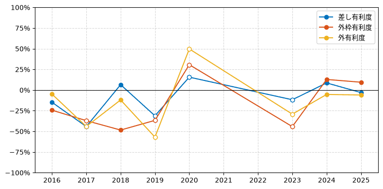

## [25年 Aコース7日目 (良)](https://race.netkeiba.com/race/result.html?race_id=202508030711)

勝ちタイム: 1:58.3  
1000m通過: 59.4

| 差し有利度 | 外枠有利度 | 外有利度 |
| --- | --- | --- |
| -3% | +9% | -6% |

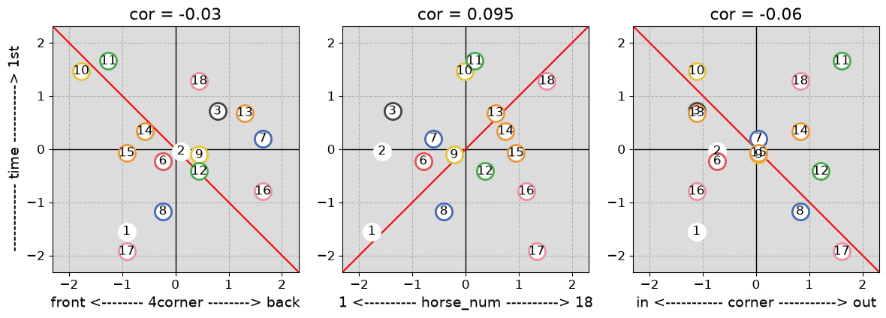

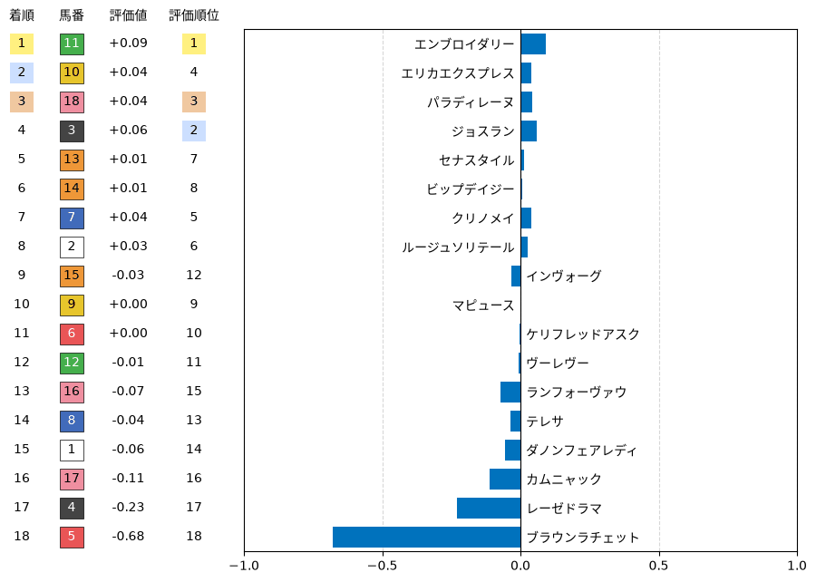

## [24年 Aコース4日目 (良)](https://race.netkeiba.com/race/result.html?race_id=202408050411)

勝ちタイム: 1:57.1  
1000m通過: 57.1

| 差し有利度 | 外枠有利度 | 外有利度 |
| --- | --- | --- |
| +9% | +13% | -5% |

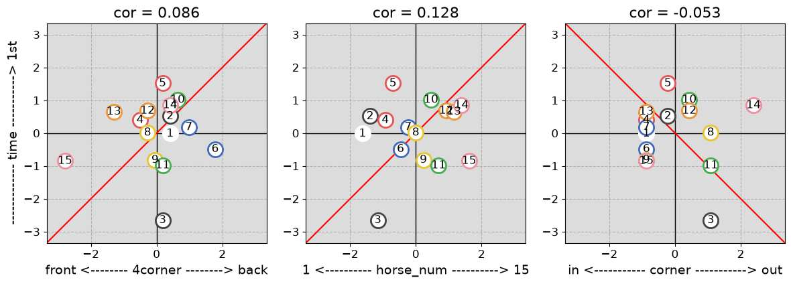

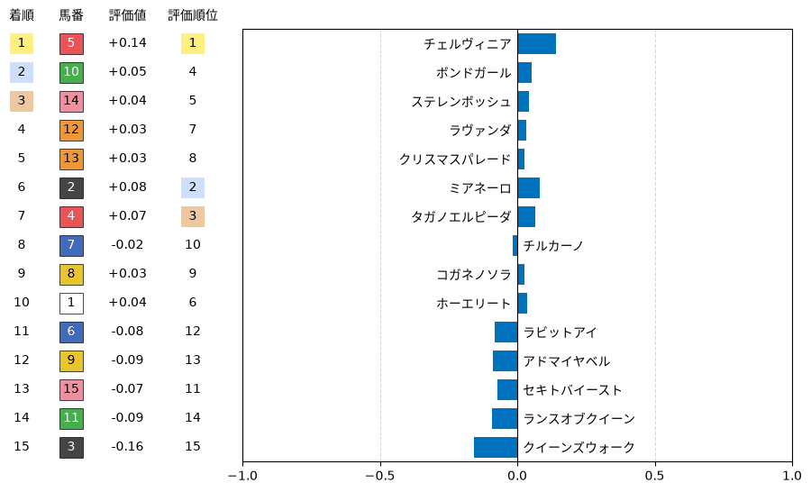

## [23年 Aコース5日目 (稍重)](https://race.netkeiba.com/race/result.html?race_id=202308020511)

勝ちタイム: 2:01.1  
1000m通過: 1:01.9

| 差し有利度 | 外枠有利度 | 外有利度 |
| --- | --- | --- |
| -12% | -44% | -29% |

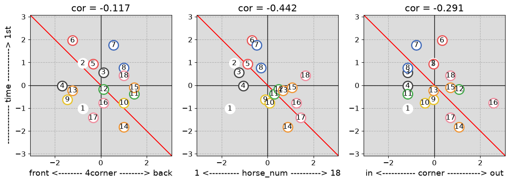

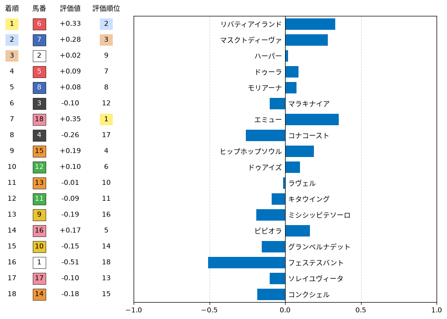

## [20年 Aコース4日目 (稍重)](https://race.netkeiba.com/race/result.html?race_id=202008040411)

勝ちタイム: 2:00.6  
1000m通過: 59.4

| 差し有利度 | 外枠有利度 | 外有利度 |
| --- | --- | --- |
| +16% | +31% | +50% |

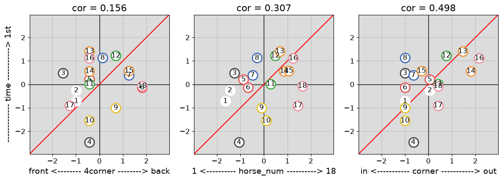

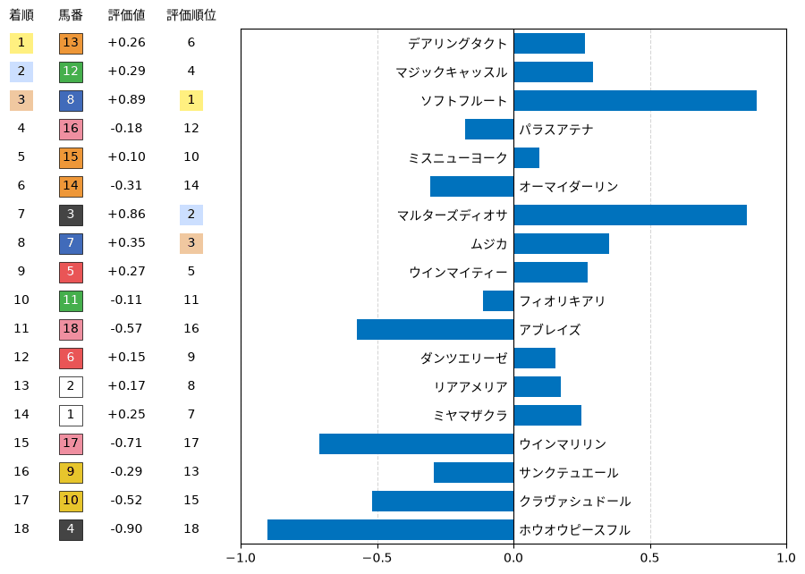

## [19年 Aコース4日目 (稍重)](https://race.netkeiba.com/race/result.html?race_id=201908040411)

勝ちタイム: 1:59.9  
1000m通過: 58.3

| 差し有利度 | 外枠有利度 | 外有利度 |
| --- | --- | --- |
| -31% | -37% | -57% |

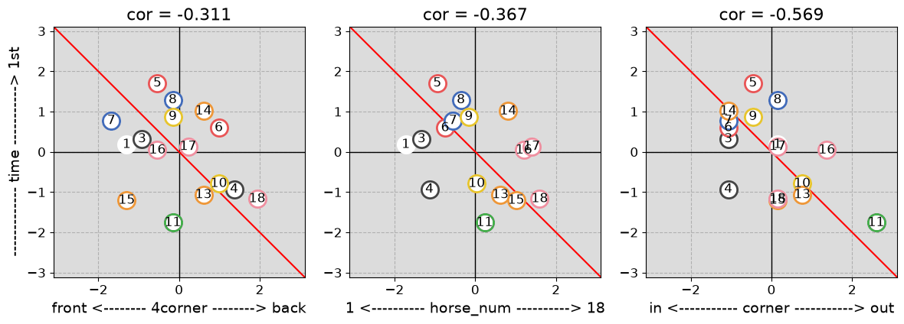

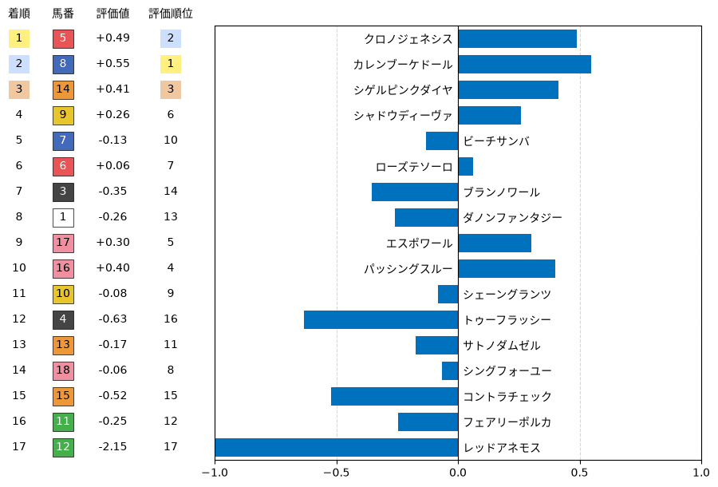

## [18年 Aコース5日目 (良)](https://race.netkeiba.com/race/result.html?race_id=201808040511)

勝ちタイム: 1:58.5  
1000m通過: 59.6

| 差し有利度 | 外枠有利度 | 外有利度 |
| --- | --- | --- |
| +7% | -48% | -12% |

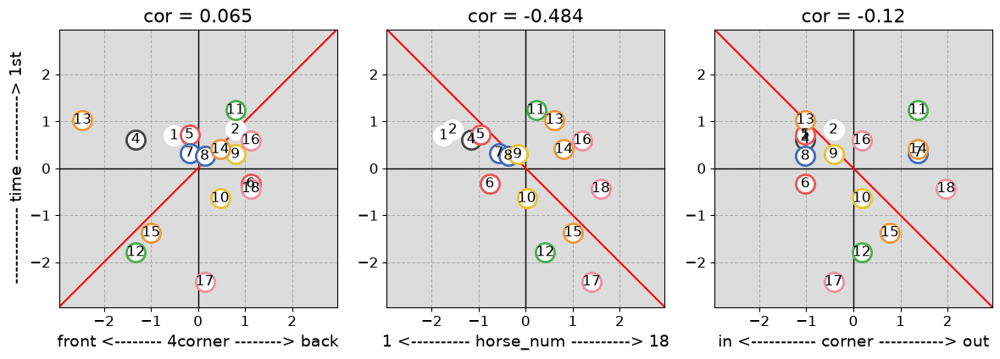

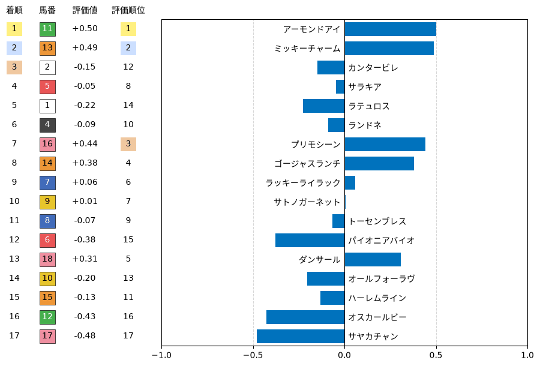

## [17年 Aコース5日目 (重)](https://race.netkeiba.com/race/result.html?race_id=201708040511)

勝ちタイム: 2:00.2  
1000m通過: 59.1

| 差し有利度 | 外枠有利度 | 外有利度 |
| --- | --- | --- |
| -44% | -37% | -44% |

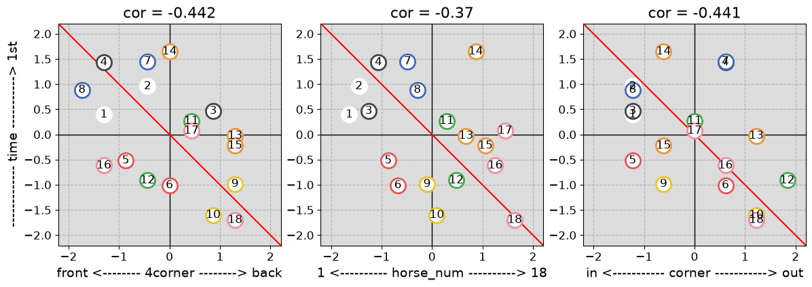

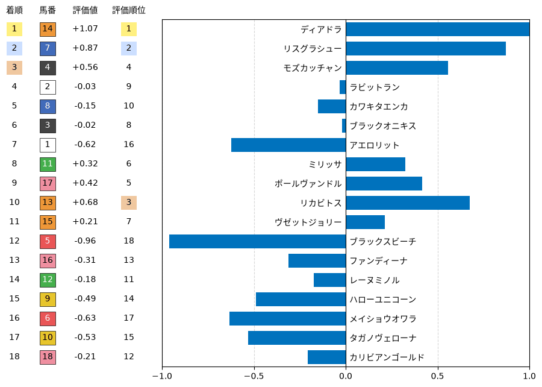

## [16年 Aコース5日目 (良)](https://race.netkeiba.com/race/result.html?race_id=201608040511)

勝ちタイム: 1:58.6  
1000m通過: 59.9

| 差し有利度 | 外枠有利度 | 外有利度 |
| --- | --- | --- |
| -15% | -24% | -5% |

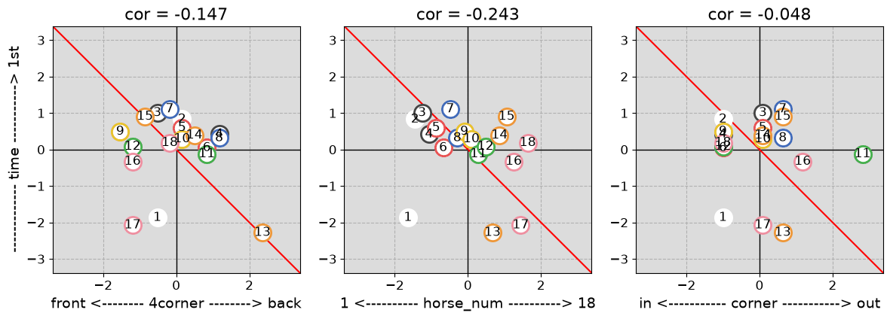

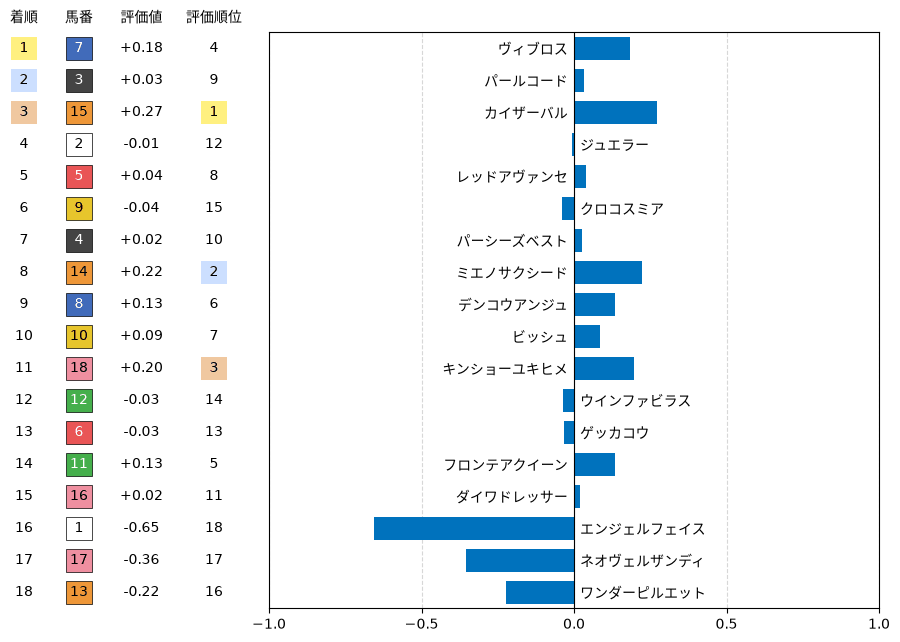

